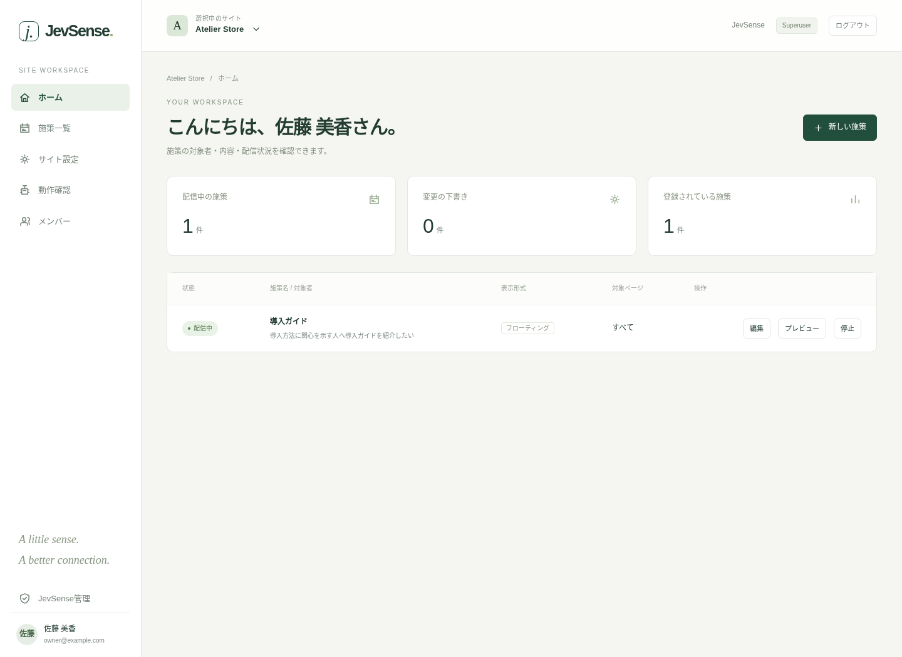

# JevSense

**閲覧の文脈を察知・判定し、用意したコンテンツを届けるWebパーソナライズ基盤。**

[ヘルプ・セットアップガイド](https://manji6.github.io/jev-personalization/) · [施策の作り方](https://manji6.github.io/jev-personalization/guides/campaigns) · [Issues](https://github.com/manji6/jev-personalization/issues) · [MIT License](LICENSE)

JevSense（ジェブセンス）は、マーケターが「何を伝えたいか」「どんな関心・状態の人に届けたいか」を入力すると、サイト上の閲覧情報を材料にJevで対象者を判定し、事前登録したオファーを表示するセルフホスト型アプリケーションです。ECだけでなく、BtoB・メディア・採用・教育・予約サービスにも使えます。

> このブランチはパスキー対応の管理画面v2です。本番反映前の機能を含みます。コードを確認する場合は`feature/admin-v2-implementation`を使用してください。稼働中の環境は別途Previewで確認してから更新します。



## 主な機能

- **判定条件の入力支援** — 案内内容と関心・状態から、固定テンプレートで独立したYes/No質問を作成。生成AIによる文章変換は使いません。
- **共通タグによる自動観測** — 閲覧順序・表示中の時間・ページの名称/説明/種類/テーマを取得。JSON-LDからOGP・meta・titleへフォールバックします。
- **オファー表示** — モーダル、フローティングバナー、通知バー、独自JavaScript。サイト単位で基本デザインを管理します。
- **配信前の確認** — 下書き保存と配信開始を分離。1回限りの実ページプレビューと、送信内容・判定結果の診断パネルを利用できます。
- **複数サイト・ユーザー管理** — メールをIDとするパスキー認証、Superuser、サイトごとの管理者/編集者/閲覧者、手動招待と復旧コード。
- **Cloudflare対応** — Workers、D1、Durable Objects。Previewで確認したコミットを指定してProductionへリリースできます。

## 仕組み

```text
サイトのSDK → ブラウザ内の閲覧履歴
                    ↓ 判断するタイミングだけ
                自前のAPI → Jev（Noul）
                    ↓
             登録済みオファーを表示
```

閲覧者の履歴・表示済み状態はブラウザのsessionStorageで保持します。サーバーに閲覧者ID・閲覧者セッション・行動履歴DBは作りません。管理者のアカウント・認証・所属・設定は管理用DBに保持します。

フォーム入力、ページ全文、JSON-LD全体をそのまま送信しません。ページ情報にも個人情報が含まれることがあるため、収集範囲と同意の設計は導入時に確認してください。Jevの判定値は購入率や施策効果を表すものではありません。

## クイックスタート

Node.js **24以上**が必要です。

```sh
git clone --branch feature/admin-v2-implementation https://github.com/manji6/jev-personalization.git
cd jev-personalization
npm ci
npm run review
```

**http://localhost:4174/admin** を開きます。初回登録用の値は`local-review-only-not-a-production-token`です。これはローカル確認専用で、本番では使いません。

実際のパスキー・DB保存・施策管理・表示処理を試せます。Jev判定だけは固定のスタブで、外部のJev APIやCloudflareを呼び出しません。確認用ページはhttp://localhost:4174/demo。状態は`data/review.sqlite`に保存されます。

## セットアップ

### Cloudflareで運用する

Cloudflareアカウント、JevのAPIキー、本番/確認用のD1を用意します。リポジトリの`wrangler.json`には開発環境のIDが含まれるので、自分のアカウント・Worker名・DB・Originへ必ず変更してください。

[Cloudflareセットアップガイド](https://manji6.github.io/jev-personalization/getting-started/cloudflare)に沿って、実行時SecretとAccessを設定し、Previewで確認します。

```sh
npm run cf:preview
# Previewで確認後、明示的に本番へ反映する
npm run cf:release -- --reviewed-commit FULL_40_CHARACTER_COMMIT_SHA
```

本番と確認用でDB・認証・費用カウンターを分離します。このリポジトリのCIは検査だけを行います。Cloudflare Builds等を別途連携している場合は、自動の本番配備を無効にして上の手動リリースへ統一してください。[リリース手順](docs/cloudflare-preview.md)も参照してください。

### Node.jsで運用する

永続ディスクとHTTPSを用意し、`AUTH_MODE`、`AUTH_ORIGIN`、`AUTH_SECRET`、初回登録用`ADMIN_TOKEN`、`JEV_API_KEY`を実行環境へ設定して`npm start`します。既定は127.0.0.1:3000、管理DBは`data/administration.sqlite`です。

[Node.jsセットアップガイド](https://manji6.github.io/jev-personalization/getting-started/node)に、環境変数・初期設定・リバースプロキシ・バックアップの詳細を記載しています。

## ページへの組み込み

サイト設定を作成し、共通タグを1つ設置します。

```html
<script
  src="https://YOUR-API-HOST/sdk.js"
  data-api="https://YOUR-API-HOST"
  data-site="YOUR-SITE-ID"
></script>
```

SDKの読み込み完了後、利用者の同意を取得してから呼び出します。

```js
window.JevPersonalization.consent(true);
```

サイトの許可Origin・収集/除外経路・メタデータ送信・施策の有効化が必要です。[SDK連携ガイド](https://manji6.github.io/jev-personalization/integration/sdk)を参照してください。

## ドキュメント

- [利用者向けヘルプ](https://manji6.github.io/jev-personalization/) — 導入、画面操作、表示デザイン、SDK、診断、運用、FAQ。
- [詳細設計](docs/admin-v2-design.md) — 認証・権限・下書き・実ページプレビュー。
- [Preview / Production運用](docs/cloudflare-preview.md) — 分離構成と確認後の本番反映。
- [検証範囲](docs/admin-v2-validation.md) — 自動テストと実機確認の範囲。

## 開発・テスト

```sh
npm ci
npm run check
npm run test:cloudflare
npx playwright install chromium
npm run test:browser
npm run format:check
```

ヘルプサイトもMarkdownで管理します。

```sh
npm run help:dev
npm run help:build
```

Node.js版は単一プロセス向けです。Workers版はD1とDurable Objectsで状態・クォータを共有します。実機パスキー、対象サイトのCMP/CSP/SPA、想定負荷は運用環境でも確認してください。

## 対象外・今後の機能

任意の文章の生成AI変換、メール自動送信、成果集計・A/Bテスト、課金、画像アップロード基盤は含みません。画像はHTTPS URLを指定し、招待は期限付きリンクを手動共有します。

## コントリビュート

不具合報告・改善提案は[Issues](https://github.com/manji6/jev-personalization/issues)へお願いします。再現手順、利用環境、期待する動作を添えてください。APIキー、管理トークン、Cookie、個人情報、実際の閲覧履歴は投稿しないでください。

## ライセンス

[MIT License](LICENSE)。JevやCloudflare等、外部サービスの契約・料金・データ取扱条件はそれぞれの提供元で確認してください。
