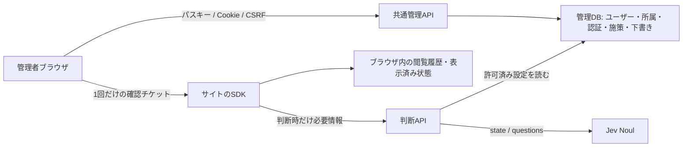

# 管理画面v2 詳細設計

実装対象日：2026-10-31。承認された[操作モック](prototypes/admin-v2.html)を、Node.jsとCloudflare Workersの両方で動く本実装にした仕様です。[従来の検討記録](admin-v2-plan.md)とは区別します。コードとローカル検証が対象で、本番環境への適用・公開は別の操作です。

## 1. システム構成とデータの境界



閲覧者ID・閲覧者のサーバーセッション・行動履歴DBは追加しません。管理者のログイン情報を永続化する管理用DBは別の目的です。フォーム入力、ページ全文、JSON-LD全体は引き続き送信しません。

`src/admin/service.js`は標準Request/ResponseとD1相当のSQLインターフェースを使います。WorkersはD1のprimary session、Node.jsは組み込みSQLiteと同じSQLを利用します。Node.jsの公開判定処理は既存Fastify実装を継続利用します。

管理画面は`public/admin-v2.html`、モックから引き継いだCSS、`src/admin/ui.js`をバンドルした`control.js`です。第三者のスクリプト・フォント・解析SDKに依存しません。

## 2. 画面と状態

| 画面         | 主な機能                                                                                                   |
| ------------ | ---------------------------------------------------------------------------------------------------------- |
| 初回登録     | 既存管理トークンで権限確認、表示名・メール・最初のパスキー登録、Superuser作成                              |
| ログイン     | メールをIDとするパスキー認証                                                                               |
| 招待・復旧   | fragmentのトークンをメモリに取り込み、URLから除去。登録後は通常の`/admin`へ移動                            |
| ホーム       | 配信中・下書きの件数と施策一覧。成果や購入率の架空表示はしない                                             |
| 施策一覧     | 全状態の一覧・検索・状態絞り込み・編集・停止/再開・実ページプレビュー                                      |
| 施策編集     | 対象者・条件 / 表示コンテンツ / 配信設定、下書き保存と配信確認を分離                                       |
| サイト設定   | 名称・Origin・収集範囲・除外・計測条件・任意連携・形式別共通デザイン                                       |
| 動作確認     | 実サイトの診断パネル起動、タグ例と設置説明                                                                 |
| メンバー     | 手動招待リンク、取消、サイト権限変更・所属解除                                                             |
| アカウント   | 自分の表示名、パスキーの追加/削除、復旧コード、他セッション終了                                            |
| JevSense管理 | Superuser専用。全サイト・全ユーザー・有効/無効・全体権限・復旧リンク・モデル/費用上限・直近100件の管理操作 |

ヘッダーで所属サイトを切り替えます。Superuserには全サイトを列挙し、一般ユーザーには所属サイトだけを返します。表示名は初回登録・新規招待受諾時に入力し、アカウント画面で変更します。メールアドレス変更は今回の対象外です。

セレクトはモック同様、キーボード操作・選択マーク・サイトのドメインと権限を持つ共通のlistboxです。未保存の変更は画面移動・サイト切り替え・ログアウト時に確認します。サーバーの認可を画面上の非表示やdisabledで代用しません。

## 3. 認証と管理セッション

- ライブラリは`@simplewebauthn/server@14.0.3`、ブラウザ側は`14.0.0`を固定。
- 固定した`AUTH_ORIGIN`からRP IDを作り、HTTPのHostや入力値でRPを変更しません。HTTPS必須。開発用に`http://localhost`だけを例外とします。
- 登録はattestation none、discoverable credential必須、ユーザー検証必須。ES256とRS256を受け付けます。署名・challenge・Origin・RP ID・UV・counterを検証します。
- challengeは5分、ブラウザ用HttpOnly Cookieのハッシュに結び付け、一度だけ消費します。再認証では管理セッションにも結び付けます。
- 管理Cookieは`__Host-jevsense_session`、Secure・HttpOnly・SameSite=Lax・Path=/・Domainなし。256bit乱数を使いDBにはハッシュを保存。ブラウザのWeb StorageやURLには保存しません。
- 無操作30分、絶対12時間。最終利用の書き込みは最大1分に1回。ログアウト、ユーザー停止/全体権限変更、復旧、他セッション終了で失効します。
- 管理用の書き込みは固定Originと`X-JevSense-CSRF`を検証。管理APIはCORSを許可しません。本文64KiB、IP制限は既存の60要求/分を共用します。
- パスキー追加/削除、復旧コード発行、招待/権限変更、全体設定などでは5分以内のパスキー認証を要求。不足時はHTTP 428で再認証を促します。
- 最後の有効なSuperuserと、最後のパスキーはDBトリガーでも保護します。同期パスキーの秘密鍵をサーバーに保管しません。

初回登録完了時だけ、最初のユーザーとパスキー作成・既存サイトの最新コピー・initialized切り替えを同一DBバッチで行います。競合する初回登録は後続を拒否します。以後、ADMIN_TOKENを通常のログインや管理APIへ利用できません。

`AUTH_SECRET`は診断認可のHMACに使う独立した32文字以上のシークレットです。管理セッション自体はランダムなDB参照型です。AUTH_SECRETの変更だけで既存の管理セッションが終了するとは扱いません。

## 4. 権限

| 操作                                   | Superuser | サイト管理者 | 編集者     | 閲覧者     |
| -------------------------------------- | --------- | ------------ | ---------- | ---------- |
| サイト・施策の参照                     | 全サイト  | 所属サイト   | 所属サイト | 所属サイト |
| 標準施策の編集・配信・プレビュー・診断 | 可        | 可           | 可         | 不可       |
| 独自JavaScript施策の変更・プレビュー   | 可        | 可           | 不可       | 不可       |
| サイト設定・共通デザイン・所属管理     | 可        | 可           | 不可       | 不可       |
| サイト新設・全ユーザー・全体設定       | 可        | 不可         | 不可       | 不可       |
| 自分のプロフィール・パスキー           | 可        | 可           | 可         | 可         |

APIはサイトIDごとに所属を再確認します。書き込みの条件付きSQLにも現在の権限を含めます。全体権限変更ではuser versionを更新して既存セッションを終了。所属変更は次の要求から有効です。独自コードを標準形式へ変換する操作も管理者専用です。

診断認可にも発行者IDとuser versionを署名し、検証時に有効ユーザー・現在のサイト編集権限を確認します。ユーザー停止や所属解除で診断も停止します。単なるログアウトで既発行の診断認可を個別消去する仕組みではなく、最長15分の有効期限です。

## 5. 招待と復旧

メール送信サービスを必要としない手動共有が初期運用です。メールはIDとして利用し、所有確認済みという表示や状態を作りません。将来のメール配送を追加しても、招待の発行・検証・単一消費のAPIを再利用できます。

招待は256bit乱数・DBにはハッシュ・24時間・1回限り。発行者の現在のサイト管理権限も受付時に確認します。同じメールへの再発行は旧リンクを無効にします。新規ユーザーは表示名とパスキーを登録。登録済みユーザーは既存のパスキーでログインし、招待メールと一致する本人だけが所属を追加できます。招待リンクだけで既存アカウントを取り替えません。

自分用の復旧コードは8個。発行時だけ表示し、DBはユーザーIDと結び付いたハッシュを保存します。新しい発行で旧コードを無効化。復旧は通常の編集セッションを直接与えず、新しいパスキー登録だけを許すchallengeを経由します。完了時は旧パスキー・旧セッション・残りの復旧コード・対象者の復旧リンクを無効にします。復旧後にコードを再発行します。

Superuserは本人確認後、5分・1回限りの復旧リンクも発行できます。メールだけで復旧する公開エンドポイントはありません。DB操作ができる運用者向けの最終復旧手順は[移行・運用手順](admin-v2-setup.md)に分離します。

## 6. DBと競合制御

`migrations/0002_administration.sql`は既存のapp_configを削除しない追加移行です。

| テーブル                                      | 用途                                                                   |
| --------------------------------------------- | ---------------------------------------------------------------------- |
| admin_settings                                | 初期登録済みフラグ、環境名、モデル、日次上限、同時実行上限、revision   |
| admin_users / admin_credentials               | メール・表示名・全体権限・状態・user version / パスキー公開鍵・counter |
| admin_sessions / admin_challenges             | 管理セッションのハッシュ・CSRF・期限 / 単一消費の認証challenge         |
| admin_sites / admin_memberships               | サイト別JSON・revision / ユーザーとサイトの多対多・サイト権限          |
| admin_drafts                                  | 施策単位の未公開JSON・revision・編集開始時の配信内容ハッシュ           |
| admin_invitations / admin_recovery_codes      | 招待/復旧リンクと復旧コードのハッシュ・期限・消費状態                  |
| admin_preview_tickets / admin_preview_modules | 1回の確認表示と独自JSの短期取得権限                                    |
| admin_audit                                   | 管理者ID・操作・対象・時刻。閲覧履歴や要求本文・生トークンを記録しない |

サイト更新は`If-Match`でrevision比較。下書きは下書き自身のrevisionで比較し、最初の保存ではサイトrevisionも照合します。配信開始は元の配信施策ハッシュ・下書きrevision・現在のサイトrevisionを検証して条件付き更新します。古い編集で別の人の変更を上書きしません。競合した下書きは一覧から再確認するか、明示的に破棄して作り直します。

途中の入力を含む下書きは公開設定から分離します。空の表示タイトルや未完成の判定条件を配信できません。既存の手動質問も維持し、入力支援への切り替えは操作した場合だけ行います。1サイト最大5施策・合計10質問・1施策最大5質問は継続。サイトは最大100、保存下書きはサイトあたり最大20です。

## 7. 文章から判定質問へ

案内する内容と、判定したい関心・状態を各400文字以内で入力します。各条件を1問へ機械的に当てはめ、画面とAPIで同じ関数を使用します。入力文の言い換えや生成AIの呼び出しはしません。

```text
今回案内する内容：{offer}
閲覧履歴と連携された行動・状態の情報に基づき、この閲覧者に「{condition}」が当てはまりますか？
```

質問はNoul形式で、別の質問の回答を参照しません。複数条件はコードでall/anyを適用。閾値は既存仕様の厳密な`p > threshold`です。質問欄はテンプレート分を含め1000文字以内。入力例と複合条件の注意を表示します。確率を購入率・施策効果と同一視しません。伝える内容と関心の対応が妥当かの最終確認は利用者が行います。

## 8. 実ページプレビュー

1. 一覧のプレビューから確認URLを入力。登録Origin・許可/除外経路・施策の対象パスをサーバーで確認。
2. 保存済み下書きを優先し、なければ配信中/停止中の保存内容を使う。未保存の編集は含めない。
3. 開いたタブへ非秘密の起動マーカー（管理画面Origin・nonce・元のfragment）だけをfragmentで渡す。チケット・管理Cookie・管理トークンをURLに載せない。
4. SDKは通常計測/判定より前にマーカーを読み、URLから除去。opener・Origin・nonce・siteIdを照合してpostMessageでチケットを受け取る。
5. 引換APIはOrigin、現在のpath、発行者の現在の権限、サイト/下書きrevisionを再確認。SQLの条件付き更新で1回だけ消費する。期限5分、URL・施策・サイトに限定。
6. 標準レンダラーで描画し「確認表示中」を表示。Jevを呼ばず、通常の履歴・dismissed・表示回数・通常配信イベントを更新しない。
7. 閉じる/SPA遷移で除去。再読み込み後は強制表示されない。確認表示として起動したページでは通常配信を休止し、通常配信の検証は別のページ表示で行う。

独自JavaScriptは専用の30秒・1回限りのモジュール取得権限を別に発行します。登録済みコードをimmutableな取得行へ保存し、通常配信の有効施策用URLを流用しません。context.modeを`preview`として作者にも通知します。独自コードがサイトと同じ権限で行う副作用の取り消しまでは保証しません。

引換後にCSP・描画エラー・タブ終了が起きた場合もチケットは消費済みです。「必ず1回表示」ではなく「1回の起動を認可する」仕様で、失敗したら再発行します。最新版SDKの設置、ポップアップ許可、openerを維持できるサイトのCOOP設定が必要です。CMPでSDK自体が読み込まれない場合は起動できません。

## 9. API一覧

| URL                                                               | 主なメソッドと役割                                    |
| ----------------------------------------------------------------- | ----------------------------------------------------- |
| /auth/status                                                      | GET 初期登録状態                                      |
| /auth/setup/options /auth/register/verify                         | POST 初回/招待/復旧/追加の登録署名検証                |
| /auth/login/options /auth/login/verify                            | POST パスキー認証                                     |
| /auth/session /auth/logout                                        | GET 本人/所属/CSRF、POST ログアウト                   |
| /auth/reauth/options /auth/reauth/verify                          | POST 重要操作の再認証                                 |
| /auth/invitation/inspect /register /accept                        | POST 招待確認・新規登録・既存ユーザーの受諾           |
| /auth/recovery/options                                            | POST 復旧資格で新しいパスキー登録を開始               |
| /admin/api/v2/profile /passkeys /recovery-codes /sessions         | 本人のプロフィール・認証・セッション                  |
| /admin/api/v2/sites                                               | POST Superuserのサイト作成                            |
| /admin/api/v2/sites/:siteId                                       | GET サイトと下書きの読み込み                          |
| /admin/api/v2/sites/:siteId/settings /members /invitations        | サイト設定・所属・招待                                |
| /admin/api/v2/sites/:siteId/campaigns/:id/draft                   | PUT 下書き保存、DELETE 破棄                           |
| /admin/api/v2/sites/:siteId/campaigns/:id/publish /stop /preview  | POST 配信開始・状態変更・確認チケット                 |
| /admin/api/v2/sites/:siteId/debug                                 | POST 現行診断の認可                                   |
| /admin/api/v2/system /users /users/:id /users/:id/recovery /audit | 全体設定・ユーザー・復旧・監査                        |
| /v1/preview/redeem /v1/preview/module/:token.js                   | POST 一度だけの確認取得、GET 一度だけの独自コード取得 |

400は入力/認証検証の失敗、401は未ログイン、403は権限/Origin/CSRF、409は競合や最後の管理者保護、410は期限/使用済み、428は再認証、429は制限超過です。エラーにシークレット・SQL・上流の要求本文を含めません。

## 10. 検証と適用範囲

[受入・検証記録](admin-v2-validation.md)を参照。実行環境はNode.js24、workerd、Chromiumの仮想CTAP2認証器です。公開前には利用者による実機パスキーでの最終確認を行います。Safari/Firefox・同期プロバイダー・大規模負荷・外部のセキュリティ監査の完了を、このテスト結果から推測しません。メール送信・成果集計・課金・画像アップロードは今回追加しません。
