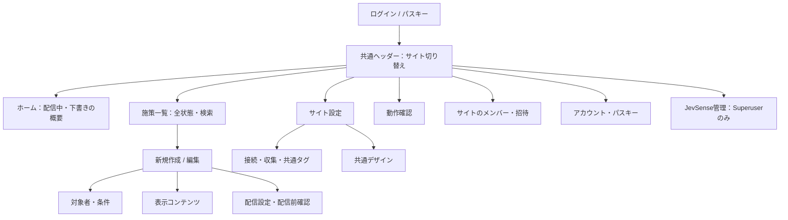
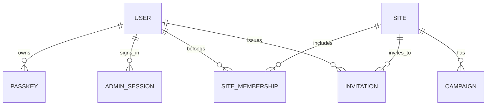

# 管理画面v2：認証・サイト所属・画面構成の検討

検討日：2026-10-31（日本時間）。この文書は実装前の設計案。現在の管理トークン認証は維持し、別URLの操作モックと技術実験を先に確認する。本番のパスキー認証・ユーザーDB・移行はまだ実装していない。

## 今回の合意と提案

- 1つのインストール環境に複数サイトと複数ログインユーザーを持つ。
- ユーザーのログインIDはメールアドレス。アカウントは環境内で1つ。サイトごとに作り直さない。
- ユーザーとサイトの所属は多対多で、同じ人でもサイトごとに異なる権限を持てる。
- ログインの本人確認はパスキーを基本とし、共有パスワードを通常運用から外す。
- **初期版の招待は、期限付きリンクを管理者が手動共有する。メール送信サービス・送信費用を初期導入の前提にしない。** 将来、同じ招待処理へメール配送を追加する。
- ログイン後の共通ヘッダーで所属サイトを切り替え、各画面は選択中サイトのデータだけを扱う。
- サイト設定・メンバー管理と、環境全体の管理、個人アカウント設定を分ける。
- 実施結果の集計は別フェーズ。最初のホームでは施策の設定状態を表示し、未実装の成果指標を実績のように見せない。

現状のADMIN_TOKENはサイト別ではなく、環境全体に対する管理権限。現状の/admin/api/configも全サイトの設定を読み書きする。サイトセレクターの追加だけではアクセス制御にならず、API・保存処理もサイト単位へ分離する必要がある。

## 操作モック

[単独で開けるHTML](prototypes/admin-v2.html)。HTMLを手元に保存してダブルクリックすればブラウザで開ける。外部公開やCloudflareへのアップロードは不要。リポジトリを手元に置く場合は `npm run preview:admin` でも確認でき、127.0.0.1:4173のみに待ち受ける。本番アプリにはモック用のルートを追加しない。固定の架空データだけを使い、API・Jev・メール・本物のパスキーへアクセスしない。画面上部でシナリオと権限を切り替えられる。

確認できる流れ：

1. メールアドレス入力 → パスキー認証のダイアログを再現 → ホーム。
2. ヘッダーからサイト切り替え。権限が違うサイト・所属サイトが1つだけの状態も再現。
3. 施策一覧 → 状態フィルター・検索 → 新規作成／編集 → 下書き保存／配信確認。
4. 未保存の状態でサイト・画面を変えようとした場合の確認。
5. サイト設定の「接続・タグ」「共通デザイン」。
6. 独立した動作確認画面。
7. サイトのメンバー招待 → 手動共有用リンクの発行イメージ → 招待された側のパスキー登録。
8. 環境全体のサイト追加・ユーザー所属の確認。
9. 個人のパスキー追加・削除、コードによる復旧、他端末のログアウト。

モックの制約：パスキー登録・認証は成功操作の再現であり、本物の認証ではない。作成・保存・招待はブラウザのメモリ内だけ。再読み込みで元に戻る。既存データや実配信に変更はない。既存の全設定項目を複製するのではなく、情報の配置と主要フローを確認するためのもの。UIの権限制御は見え方の確認であり、本番の認可保証ではない。

## 情報構造

「新規施策作成」は施策一覧の主ボタンから開く。サイドバーに同等の大項目を重ねず、施策編集は一覧から続く画面にする。ログイン後のサイトはサーバーが返した所属一覧から選び、直前サイトが今も許可されていれば復元。所属がなくなっていたら別の所属サイト、所属が0なら専用の空状態へ進む。他サイトへ切り替えると編集対象の施策ID・検索・診断先をリセットし、未保存内容の扱いを確認する。

実装時のURL案：

- /admin/login、/admin/invite、/admin/recover、/admin/setup
- /admin/sites/:siteId/home
- /admin/sites/:siteId/campaigns
- /admin/sites/:siteId/campaigns/new、/admin/sites/:siteId/campaigns/:campaignId
- /admin/sites/:siteId/settings、/admin/sites/:siteId/diagnostics、/admin/sites/:siteId/members
- /admin/account、/admin/installation

サイトIDをURLに持たせ、再読み込み・共有・戻る操作・複数タブで同じサイトを再現できるようにする。最後に選んだサイトは便宜上の保存値であり、権限の根拠にしない。アカウント画面とJevSense管理はサイト切り替えと独立した画面であることを実装時のパンくずにも示す。

Superuserはこのインストールの全サイト・ユーザー・設定を管理する役割。将来のJevSense設定（モデル接続・利用上限・招待方式など）も専用の「JevSense管理」に集約する。サイトの見た目・経路設定とは別にする。別にインストールされた環境まで横断するベンダー用の特権アカウントは設けない。

## データの関係

「環境」は1インストール単位なので、初期版に別組織のテナント管理は追加しない。別のインストール環境では同じメールでも別アカウント。Superuserは全サイトへアクセスでき、通常の所属はサイト単位。ユーザーIDはランダムID、パスキーのuserHandleもメール以外のランダムな不変値を使う。

メールアドレスはtrimと定義済みの大文字小文字正規化で環境内一意とし、Gmailのドット・+タグ等で別アドレスを勝手に統合しない。アカウント停止・削除・メール変更は別操作とし、ユーザーが同じメールを入力したことだけで既存アカウントへリンクしない。

## Superuserと権限案

| 操作                                   | Superuser | サイト管理者   | 編集者     | 閲覧者     |
| -------------------------------------- | --------- | -------------- | ---------- | ---------- |
| 所属・許可されたサイトの閲覧           | 全サイト  | 管理するサイト | 所属サイト | 所属サイト |
| 標準施策の作成・編集・配信・停止       | 可        | 可             | 可         | 不可       |
| サイトの接続・収集・共通デザイン変更   | 可        | 可             | 不可       | 不可       |
| 独自JavaScriptの許可・コード登録・変更 | 可        | 可             | 不可       | 不可       |
| サイトのメンバー招待・権限管理         | 可        | 自サイトのみ   | 不可       | 不可       |
| 診断認可の発行                         | 可        | 可             | 可         | 不可       |
| 環境へのサイト追加・Superuserの変更    | 可        | 不可           | 不可       | 不可       |
| 自分のパスキー・セッション管理         | 可        | 可             | 可         | 可         |

Superuserの権限とサイトの権限は別に保存する。最後の有効なSuperuserを停止・削除・降格できないよう、DBの更新条件を含めて競合に耐える制御をする。Superuserの昇格やユーザー復旧は再認証を要求する。サイトの管理者が、招待APIのroleを改ざんしてSuperuserを作ることはできない。

編集者から独自コードを編集できないようにするには、フォームを隠すだけでは不十分。APIで変更可能な項目を検証する。既存の全設定PUTを編集者へ開放しない。独自コードを含む施策の編集・配信権限も、初期版ではサイト管理者以上へ限定する案とする。

## パスキーの技術構成

第一候補は、WebAuthn + SimpleWebAuthnをアプリ側で実装し、WorkersのWeb CryptoとD1を使う構成。外部の認証SaaSを必須にせず、既存のCloudflare導入を維持できる。暗号処理やWebAuthnのバイナリ検証は自作しない。

2026-10-31に @simplewebauthn/server 14.0.3 を、既存アプリに追加しない隔離環境で実験した。Miniflareのworkerd、nodejs_compatなし、Chromiumの仮想CTAP2認証器で、次を実測した。

- ES256・discoverable credential・本人確認必須で登録成功。
- ブラウザが生成した署名付き認証応答の検証成功。
- 消費済みchallengeの再利用、想定外Origin、想定外RP ID、本人確認フラグなしの署名応答を拒否。

[実験コードと結果](../experiments/auth-v2/README.md)。これはパスキーの互換性確認であって、ログインシステムの完成・安全性監査ではない。実機、同期パスキー、Safari/Firefox、ES256以外の署名方式、DB・セッション・招待・復旧は別途検証が必要。

### ドメイン

パスキーは管理画面のRP IDに紐づく。管理対象サイトごとにパスキー登録を要求しない。現在のworkers.devの管理画面でも構成できるが、将来独自ドメインへ変える場合はパスキーの再登録が必要になり得る。最初の本番登録前に、管理画面の正式OriginとRP IDを決める。リクエストのHostや転送ヘッダーからRP IDを動的に採用しない。ローカル開発用localhostは本番と別設定・別資格情報とする。

### 登録・認証

- サーバー生成の十分にランダムなchallenge、5分の期限、ceremony種別・ユーザー・匿名ブラウザ状態との結合、1回限りの消費を実装する。
- expectedOrigin、RP ID、challenge、署名、credential ID、userHandle、本人確認（UV）を検証する。
- residentKeyとuserVerificationはrequired、attestationはnoneを初期候補とする。秘密鍵・顔・指紋・端末PINはサーバーへ送らない。
- 資格情報はcredential ID、公開鍵、counter、transports、バックアップ関連フラグ等を保存する。同期パスキーのcounterが0の場合を、単純に不正扱いしない。採用ライブラリの検証と同時更新を検討する。
- メール入力型ログインを初期の明示フローにする。既存メールの有無を未認証者へ列挙させない応答・レート制限を使う。将来は条件付きUI・ユーザー名なしログインも追加できる。
- 追加登録や削除、復旧コード再発行、管理者昇格には直近のパスキー再認証を要求する。最後のパスキーの削除は通常操作から許可しない。

## 初回の導入・移行

1. DBを非破壊で追加する。既存サイトID、施策ID、タグURL、公開判断APIの形式を維持する。
2. 環境が未初期化の場合のみ初回登録画面を許可する。既存のADMIN_TOKENで環境の管理権限を確認し、最初の管理者のID・パスキーを登録する。これは通常ログインのパスワードとして残さない。
3. 登録の完了は、credentialの有効性確認と最初の所有者作成を同じ初期化フラグに対して原子的に確定する。並列操作で複数の初回管理者を作らない。
4. 移行後のサイト・施策へのアクセスと管理者の再ログイン・復旧手段を確認してから新認証へ切り替える。
5. 切り替え後は旧管理トークンによる通常の管理APIを無効化する。常時の裏口として二重運用しない。

今の管理トークンを共有していた全員へSuperuserを自動付与しない。最初のSuperuserが、各メンバーを必要なサイトと権限で招待する。

## 招待リンク：初期版

1. Superuser／サイト管理者がサイト・メールアドレス・サイト内の権限を指定する。
2. サーバーが24時間・1回限りの招待を作り、ランダムな256bit以上のトークンはハッシュでDBへ保存する。生成直後だけ共有用URLを表示する。
3. 管理者が、本人と確認できる経路でリンクを直接共有する。URLを一般公開しない。アシスタントが代理でメッセージを送信する運用は含めない。
4. 受信者が招待先サイト・権限・ログインIDを確認する。登録済みユーザーなら該当アカウントのパスキーで本人確認。新規ユーザーなら招待に結合した登録ceremonyを完了する。
5. パスキー登録／本人確認と所属追加・招待の消費を原子的に確定する。招待された別メールのアカウントへ勝手に所属を付与しない。

リンクは所持者が使える秘密情報で、メールアドレスの所有確認をしたことにはならない。初期版はメールをログインIDとして使い、email_verified_atは未設定のまま。UIも「メール確認済み」と表示しない。

URLのトークンはfragmentで受け取り、画面の初期化でURLから除去してAPIへPOSTする案。招待画面は第三者スクリプト・解析・外部画像を使わず、no-referrer・no-storeを適用する。GETやリンクプレビューで自動消費しない。トークンを通常ログや監査イベントへ保存しない。期限切れ・取消・再発行・並列受付・レスポンス喪失後の再操作を検証する。再発行は旧リンクを無効にし、新しいリンクを生成する。

将来の配送インターフェースは `deliverInvitation(invitation, deliveryMode)` のように分離し、初期版はmanual、将来はemailを追加する。招待の作成・受諾・権限検証は共有する。メール配送追加時は別途送信サービス・送信ドメイン・費用・メール所有確認・不達処理を設計する。既存の未検証メールを一括で「確認済み」に更新しない。

## 復旧

- 複数のパスキー登録を案内する。別端末・セキュリティキー・ブラウザのクロスデバイス認証を優先する。
- パスキー登録後に、1回限りのリカバリーコードを発行できるようにする。高エントロピーのコードを1度だけ表示し、サーバーはハッシュのみ保存する。
- コードで入れるのは新しいパスキーを登録する短時間の復旧状態。施策編集や権限管理へ直接ログインさせない。再登録完了時に既存の管理セッションを失効し、関連する招待・復旧状態を消費する。
- コードも使えなければ、Superuserが本人確認したうえで、再認証して期限付き・1回限りの復旧リンクを発行する。メール送信サービスは不要。復旧リンクの権限・目的を一般のサイト招待と分ける。
- 最後のSuperuserが全手段を失った場合はCloudflareコンソール／サーバー運用権限での緊急復旧とする。公開のメールフォームや旧共有トークンで環境を乗っ取れる復旧口を作らない。実装時に専用の手順・コマンドと監査を用意する。

手動共有型のリンクや復旧コードの漏洩時は、本人確認が破られるリスクがある。権限を限定し、短い期限、1回限り、取消、レート制限、再認証、監査を組み合わせる。

## 管理セッションとサイト認可

ブラウザはSecure・HttpOnly・SameSite=Lax・Path=/・Domainなしの `__Host-jevsense_session` Cookieで管理画面へアクセスする。生のトークンをlocalStorage・sessionStorage・URLへ置かない。サーバーにはランダムなセッション識別子のハッシュを保存し、ユーザー停止・権限変更・ログアウト時に失効できるようにする。期限の初期候補は無操作30分・絶対12時間で、書き込み頻度・運用に合わせて詳細化する。

管理操作にはOriginチェック、CSRF対策、操作ごとのサイト認可を入れる。ヘッダーのサイト選択値だけで認可せず、APIがuser_id + site_id + permissionを検証する。サイト一覧にも未所属サイトを含めない。招待・権限変更・独自コード編集・認可境界を越える要求はサーバーで拒否する。

これは**管理者のログインセッション**であり、SDKで計測する閲覧者のIDやセッション管理をサーバーへ追加するものではない。公開の判断APIはこれまでどおり、閲覧者DBを持たずに動作する。

## 保存構造の案

| テーブル                         | 主な役割                                                            |
| -------------------------------- | ------------------------------------------------------------------- |
| installation_settings            | 初期化状態、正式Origin・RP ID、認証移行状態                         |
| users                            | ランダムID、正規化メールID、表示名、状態、環境権限、メール確認状態  |
| passkeys                         | user_id、credential_idの一意制約、公開鍵、counter、transports等     |
| admin_sessions                   | token_hash、user_id、期限、直近の再認証・失効状態                   |
| auth_challenges                  | ceremony種別、challenge、結合先ブラウザ・ユーザー、期限・消費状態   |
| sites                            | 安定したsite_id、名前、サイト設定JSON、サイト単位のrevision         |
| site_memberships                 | user_id + site_idの一意制約、site_role                              |
| invitations                      | token_hash、対象メール、site_id・role、発行者、期限・消費・取消状態 |
| recovery_codes / recovery_grants | コードハッシュ、目的限定の復旧状態、期限・消費状態                  |
| admin_audit_events               | 誰が・どのサイトで・何を変更したか。秘密・閲覧者履歴は含めない      |

サイト設定は旧app_configからサイト単位へ移す。キャンペーンを最初からすべて別テーブルに分解する必要はないが、サイト間の読み書き・revisionは分離する。公開APIは対象サイトだけを読む共通Repositoryへ移す。D1が第一候補。Node版を維持する場合は、同じRepository契約のSQLite等の管理者DBを用意し、ファイルJSONだけで多人数の認証データを扱わない。Node版との対応範囲は実装計画で確定する。

移行はバックアップ、非破壊の追加、件数・ID・ハッシュ照合、ステージングでの旧新比較、切り替えの順。新方式で編集した後に旧JSONへ単純に戻すと変更を失うため、ロールバック時の設定エクスポート・変換と権限の扱いも設計する。

## 診断パネルの引き継ぎ

サイト限定・15分間の診断トークンとpostMessage連携は維持する。発行APIが管理Cookieの認証とサイト権限を確認する方式へ変更する。管理Cookieやパスキー情報を実サイトへ渡さない。

現在の診断トークンの署名鍵はADMIN_TOKENなので、新方式では別のAUTH_SECRET等で目的を分けた署名鍵へ移行する。新しい診断トークンは発行ユーザーと認可バージョンを識別し、ユーザー停止や所属取消後も診断だけ継続できないよう、診断要求時にも発行者・サイト権限を確認する。古いトークンは切り替え時に無効化するか、最大15分の移行時間を明示する。

## 実装の進め方

1. **今回**：関係・権限・画面構造の検討、操作モック、パスキー互換性実験。
2. モックのフィードバックを反映し、正式ドメイン・役割・復旧運用・Node版対応を確定する。
3. 詳細API、DBマイグレーション、Cookie/CSRF/再認証、競合制御、旧トークン廃止・復旧・ロールバックを設計する。
4. 認証・認可・招待を先に実装・検証し、サイト単位APIと新画面を接続する。
5. 別環境で移行・実機・複数ユーザー・権限分離・既存SDK／診断の受入試験を行う。
6. 移行手順をレビューしてから本番へ切り替える。

実装時の受入条件：未所属サイトの読取・書込拒否、任意ID差し替え・権限昇格拒否、最後の管理者の保護、招待・challenge・復旧コードの並列使用拒否、期限切れ・取消、Cookie/CSRF、ユーザー停止後の全セッション・診断認可の失効、既存タグ・サイトIDの維持、旧管理トークンでのアクセス停止。実機のパスキー、同期パスキー、Safari/Firefox、複数タブも確認する。

## 参照した公式情報

- [SimpleWebAuthn Server](https://simplewebauthn.dev/docs/packages/server)
- [SimpleWebAuthn Browser](https://simplewebauthn.dev/docs/packages/browser)
- [WebAuthn仕様](https://www.w3.org/TR/webauthn-3/)
- [Cloudflare Workers Web Crypto](https://developers.cloudflare.com/workers/runtime-apis/web-crypto/)

公式資料の確認とパッケージのバージョン確認は2026-10-31。料金やCloudflareのメール送信機能の可否はこの検討で断定せず、初期版ではメール配送へ依存しない。

## 画面例

確認用Webサイトは公開しない方針に変更した。モックは単独HTML・ローカル表示・画面例で確認する。経緯は[配備記録](deployment.md)を参照。GitHubへPushしたソースや画面例の閲覧範囲は、リポジトリ自体の公開範囲に従う。
