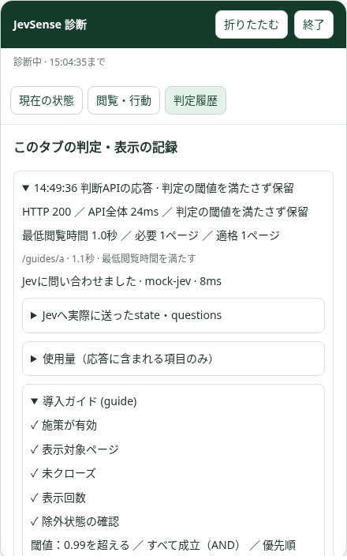

# 実サイトのデバッグパネル

## 使い方

1. 管理画面へ接続し、診断したいサイトを選ぶ。
2. 「実サイトで動作確認」に、タグを設置したHTTPSページのURLを入力する。
3. 「このサイトで動作確認」を押す。別タブの右上に「JevSense 診断」が開く。
4. 管理画面も開いたまま、実サイトで通常どおり同意・ページ閲覧・操作を行う。
5. 「終了」で閉じる。15分で自動終了する。

Chrome拡張は不要で、既存の共通タグを利用する。SDKの最大5分のキャッシュがあるため、更新直後はキャッシュを無効にして再読込する。確認先のクエリ・ハッシュは取り除いて開く。保存前の管理フォームの変更は診断に反映されない。

## 画面の見方

- **現在の状態**：同意・計測状態、現在の経路、表示中の時間、最低閲覧時間までの残り、オファー表示中かを確認する。時計の更新はブラウザ内の表示のみ。
- **閲覧・行動**：このタブ内のページ履歴、取得した名称・説明・種類・テーマ、現在ページの取得元（JSON-LD/OGP/meta/title）、許可された操作・事実、表示回数と閉じた状態を見る。
- **判定履歴**：イベントの理由、APIへ送ったJSON、応答・HTTPステータス・遅延、API側の閲覧除外、施策ごとの配信条件、実際にJevへ渡したstate・questions、質問ごとの回答値と閾値、AND/OR・優先順位、実モデル名と使用量、描画完了・失敗を確認する。各行を開くと詳細を表示する。

Jevへ送った内容と、ブラウザから自前APIへ送った内容を区別する。最低表示時間未満のページは自前APIへ生の計測値として送られるが、Jevの判断材料からは除外される。「Jevへの問い合わせ：未実行」は前処理や配信条件で止まったことを示す。確率は購入確率・施策効果ではなく、質問への判定値である。モデル内部の思考理由は生成・表示しない。

診断の認可・表示によって同意は付与されず、追加の判断要求も発生しない。通常の初回判定やイベントによって生じた要求だけを観察する。診断開始前の要求は後から復元できない。情報が足りなければ通常どおり閲覧時間の到達やページ移動を待つ。強制表示・履歴リセット・強制再判定はこの機能に含まない。

オファーが表示中は通常どおり追加要求を止める。標準モーダルが開いている間はモーダルの操作が優先されるため、閉じてからパネルを確認する。

## 記録と認可

- 記録は実サイトのタブ内メモリのみ。最大60イベント・合計1MBで古いものから削除し、大きすぎる単一イベントの詳細は省略する。サーバーに閲覧履歴や診断履歴を保存しない。
- 全ページの再読み込み・通常のページ遷移では記録を消去する。管理画面を開いていれば、同じ診断用ウィンドウ・同じ許可Origin・同じサイトIDへ期限内の認可を再送するため、移動先でも診断を続けられる。SPAでは同じ画面内にイベントを記録する。
- 同意撤回でパネル内の過去記録も消去し、撤回前の通信応答を再記録しない。終了・期限切れでも記録とSDK側の診断認可を消去する。
- 管理トークン・Jevのキーを実サイトへ渡さない。認可は15分間・サイトID・Originを限定した署名付きの診断トークン。URL・localStorage・sessionStorageへ保存せず、postMessageで渡す。送信元Origin・ウィンドウ・サイトIDを確認し、APIで署名と期限を検証してからパネルを開く。
- APIは有効な診断トークンのある要求にだけ詳細を返す。通常の応答へ質問・他施策の詳細・診断履歴を混ぜない。詳細応答はno-store。上流の認証ヘッダー・エラー本文・任意フィールドを表示しない。
- 終了はローカルな停止で、発行済みトークンをサーバーで失効管理する機能は持たない。トークンの有効期間は最大15分。管理トークンの変更でも既発行の診断トークンは無効になる。

パネルはShadow DOMで設置先のCSSから分離するが、設置先で実行されるJavaScriptから隔離された秘密領域ではない。信頼できる自分のサイトで診断する。記録には閲覧情報や施策の設定があるため、画面を共有する際は内容を確認する。自動的な外部送信やエクスポートは行わない。

## 接続できない場合

- 対象URLのOriginがサイト設定に登録されているか。設定を保存済みか。
- 最新SDKが設置され、CSPのscript-src/connect-srcでAPIホストが許可されているか。
- ポップアップを許可しているか。SDKが未設置・旧版のページではパネルを開けない。
- 管理画面が開いたままか。15分の有効期限が切れていないか。
- 対象サイトのCross-Origin-Opener-Policyなどが管理画面とのウィンドウ関係を切断していないか。切断する環境ではこの起動方式は使えない。セキュリティヘッダーを診断のためだけに緩める必要はない。
- 計測停止中なら、実サイト側の同意取得、メタデータ送信の有効化、収集対象の経路を確認する。診断パネルは同意・経路制限を回避しない。

## 実装設計

`POST /admin/api/debug-session` は既存の管理認証で保護する。保存済みのサイト設定でHTTPS・Originを検証し、既存ADMIN_TOKENをHMAC-SHA256の署名鍵として、専用audience・サイトID・Origin・期限・ランダム値を含む診断トークンを発行する。新しいSecretやDBは不要。

管理画面はボタンクリックでタブを開き、発行後に移動させる。SDKはopenerへ準備完了を通知し、管理画面は開いたタブとの対応とOriginを確認して認可を渡す。SDKもopenerとAPI Originを確認し、`GET /v1/debug-session?siteId=...` のX-JevSense-Debugヘッダーで認可を検証する。期限内の認可を持つ通常の判断要求にも同じヘッダーを付ける。CORS preflightはこのヘッダーを許可し、APIは引き続きサイトごとのOriginを検証する。

Node・Workersの双方が共通の認可・診断構築コードを使う。施策の確定条件は判断エンジンと同じ関数を利用し、診断専用の条件式へ複製しない。Jevの要求は実際の前処理結果から、回答は実応答から構築する。診断のための別モデル呼び出しはしない。SDKの表示状態は実際のonShown・close・readyで記録する。
