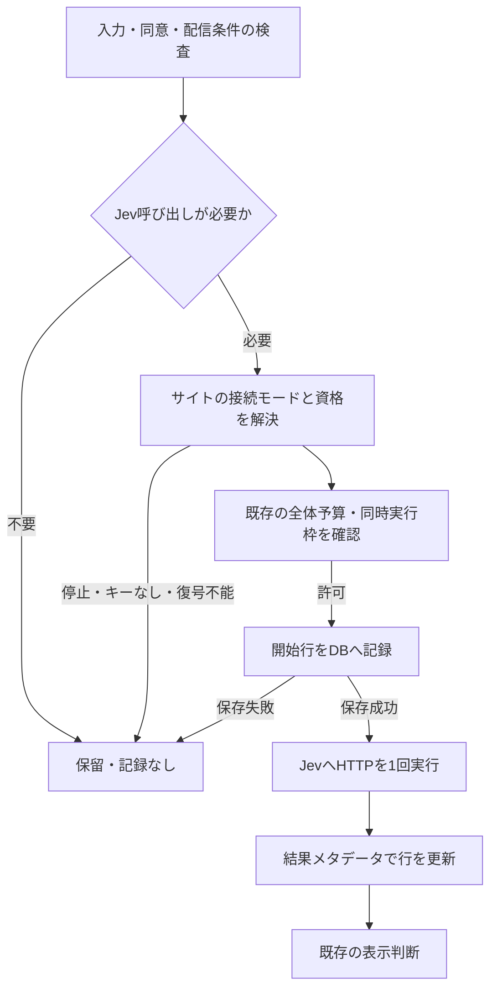

# サイト別Jev接続・利用記録 詳細設計

更新日：2026-11-02（日本時間）。管理画面v2への追加仕様です。[利用者向け操作](../help/guides/jev.md)、[暗号化キーの運用](../help/operations/jev-keys.md)、[既存の管理画面設計](admin-v2-design.md)も参照してください。Productionへの反映はPreview確認後に行います。

## 目的と権限

サイトごとにJevのAPIキーを指定し、実Jev呼び出しの運用状況を確認します。サイトの管理者と、既存の全サイト管理権限を持つSuperuserだけが、設定状態・利用記録を参照・変更できます。編集者・閲覧者・未所属者にはナビゲーションを表示せず、直接APIを呼んでも403です。

APIキーの登録・変更・削除相当の操作には管理Cookie、正確なOrigin、CSRF、直近5分以内のパスキー本人確認を要求します。SQL更新時も有効ユーザーとサイト管理権限を再確認します。保存はIf-Matchによる排他制御で、並行更新を拒否します。

## 接続モード

| モード   | 判断で使うキー         | 保存時の扱い                                           |
| -------- | ---------------------- | ------------------------------------------------------ |
| instance | 実行環境のJEV_API_KEY  | サイト専用の暗号文を消去                               |
| site     | このサイトの暗号化キー | 新規保存・置き換え。空欄は保存済み値を保持して再暗号化 |
| disabled | 呼び出さない           | サイト専用の暗号文を消去                               |

行がない既存・新規サイトはinstanceとして扱い、従来の動作を維持します。共有キーを持たず、各サイトにだけキーを設定する運用も可能です。siteモードで復号できない場合は保留し、instanceへ自動フォールバックしません。保存は接続検証を兼ねず、Jevへの問い合わせを行いません。変更前に開始済みの要求は取り消しません。

アプリからの削除はJev側の失効ではありません。DB・バックアップ中の古い暗号文が物理的に直ちに消えるという保証もしません。侵害時や利用終了時は提供元でも失効します。

## 暗号化と境界

- AES-256-GCM、保存ごとに独立した12バイトIV。AADは仕様識別子・サイトID・資格情報revisionです。他サイトや他revisionへ暗号文を移植しても認証に失敗します。
- JEV_KEYRINGはAUTH_SECRET・JEV_API_KEYと別のランダム鍵を持つキーストアです。形式はactiveとkeysのJSON、各鍵は32バイトのbase64url（パディングなし）。最大10世代。各世代名は最大40文字です。
- Workersは実行時Secretから、Node.jsは実行時SecretまたはJEV_KEYRING_FILEから読みます。通常変数・wrangler.json・Git・サイト設定JSON・ブラウザへ保存しません。Preview設定検査も平文のJEV_KEYRINGを拒否します。
- `site_jev_credentials`だけにmode/key_id/iv/ciphertext/revision/updated_atを保存し、公開サイトスキーマ・JSON出力から分離します。APIが返すのはモード・設定有無・更新日時・revision等だけで、マスク値や末尾文字も返しません。
- 入力はpassword欄、送信時にDOMから消去。値をUI状態・Storage・URL・ログへ保存せず、再表示もしません。キーの平文は処理に必要なメモリと、固定のapi.typesafe.aiへのAuthorizationヘッダーに限ります。
- HTTPS・既存の管理画面CSP・外部解析なしの方針を継続。上流へのredirectは追跡せず、再試行しません。上流エラー本文・例外メッセージを記録しません。

実行プロセスと暗号化鍵にアクセスできる運用者まで隔離する仕組みではありません。DBだけの流出に対する保護と、管理APIによるサイト境界の制御です。鍵とDBのバックアップを別々に保護します。鍵の紛失は認証情報を復元できなくするため、別途管理が必要です。

## 判断経路

Node.jsとWorkersは同じ資格解決・暗号化・記録モジュールとJevアダプターを使います。Workersの既存Durable ObjectsとNode.jsの予算カウンターは、サイト別キーでもインスタンス全体で共有します。Node.jsの予算は再起動でリセットされますが、利用記録はSQLiteに残ります。

Preview/local-reviewの固定判定は実Jevを呼ばず記録しません。キーの有効性も検証しません。利用停止は固定判定の通常判断にも適用します。強制的な実ページプレビューはJev判断を経由しません。

## 利用記録と件数の定義

`site_jev_calls`へ開始時刻、完了時刻、結果分類、要求/応答モデル、HTTP status、遅延、キー種別、資格情報revisionを記録します。主キーは各呼び出しを区別する乱数であり、訪問者IDではありません。閲覧者ID、IP、URL、Cookie、state、questions、回答、確率、要求/応答本文、キー、請求額は記録しません。応答モデル名も長さ・文字種を制限し、キーそのものを含む値を拒否します。

| 分類             | 定義                                           |
| ---------------- | ---------------------------------------------- |
| started          | 開始行を保存し、まだ結果が保存されていない     |
| success          | HTTP成功と、アダプターが受理するJSON応答を確認 |
| http_error       | HTTP失敗・redirect                             |
| timeout          | 設定タイムアウト                               |
| network_error    | HTTP応答を得る前の通信失敗                     |
| invalid_response | 成功HTTPのJSON・サイズ・基本構造が不正         |

successは「オファー表示」や「施策成功」を意味しません。閾値未達でも正常応答に数えます。不確かな確率は従来どおり表示対象にしません。

DBと外部HTTPを1つのトランザクションにはできません。開始行の書込みとHTTP開始の間に中断すると送信されていない行が残り、応答後の結果更新に失敗すると送信済みでもstartedに残ります。したがって画面の「呼び出し開始」は、上流での受信件数・課金件数・厳密なネットワーク送信数ではありません。処理中・中断・結果保存失敗は「結果未確定」とし、自動で成功/失敗へ補完しません。結果更新に失敗しても正常に取得した判断は使い、記録失敗を隠す成功行は作りません。

開始記録に失敗した要求は送信せず保留します。条件未達・予算超過・キー未設定・復号不能・停止・スタブ・配信前確認は開始行を作りません。既存の予算予約と利用記録の件数が一致するとは限りません。

## 集計・保持とAPI

UTC日単位、既定30日、1〜90日の範囲を許可。画面は7/30/90日を選べます。最新100件も表示し、更新ボタンで取得します。ポーリング・利用状況取得に伴うJev呼び出しはありません。

閲覧時・実呼び出し開始前に90日より古い行を削除します。停止中に期限どおり物理削除するスケジューラーではありません。バックアップの保持・削除も別途管理します。90日の画面範囲はUTC日の始まりを基準にし、物理削除は現在時刻の90日前を基準にします。

| API                                           | 権限・内容                                                   |
| --------------------------------------------- | ------------------------------------------------------------ |
| GET /admin/api/v2/sites/:id/jev               | サイト管理者/Superuser。接続状態のみ                         |
| PUT /admin/api/v2/sites/:id/jev               | 同上＋CSRF＋直近認証＋If-Match。modeと任意apiKeyを受け付ける |
| GET /admin/api/v2/sites/:id/jev/usage?days=30 | 同上。日別集計・合計・最新100件                              |

監査ログにはsite.jev-key.updateと操作者・サイト・時刻だけを残します。キーの値や断片は含みません。キーのrevisionはサイト設定のrevisionから独立しています。

## 移行・鍵の更新・切り戻し

0003は2つの専用テーブルとインデックスを追加する非破壊移行で、既存設定を書き換えません。Nodeは起動時に適用、Workersは配備前にD1へ適用。行がないサイトは共通キーを維持します。旧トークン方式はこの新UIを持たず、パスキー管理画面へ移行後に設定します。

暗号化鍵の世代を追加しactiveを新世代へ変更、旧世代も残して配備します。各サイトで専用キーを空欄保存すると、現在値を復号して新世代へ再暗号化します。全行と必要なバックアップの移行を確認するまで旧世代を削除しません。AUTH_SECRETの更新は暗号化鍵を変更しません。

0003以前のコードはサイト専用キーと停止モードを解釈せず共通キーを使うため、設定後に古いコードだけへ戻してはいけません。対応コードへのロールフォワードを優先します。バックアップには暗号文と、別に保管した対応するkeyringが必要です。

## 検証

[受入・検証記録](admin-v2-validation.md)を参照。実際のキー・課金APIは使わず、合成資格とモック上流でNode/SQLite・workerd/D1・Chromium/仮想パスキーを検証します。
