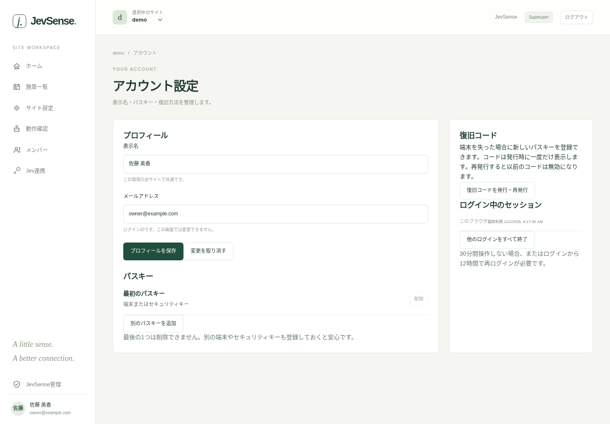

# Sign-in, accounts and invitations

## Sign in

In the admin console, enter your email address and sign in with a passkey. You verify your identity with your device's face, fingerprint or PIN, or with a supported security key. Your email address is your sign-in ID.

In a preview environment protected by Cloudflare Access, you first enter through Access with an email code or similar. This is a separate entrance from the JevSense passkey.

## First-time use

**The first administrator of an environment** registers a passkey with a display name, an email address and the initial ADMIN_TOKEN. The first user is the superuser. In a Preview linked to Access, registration is fixed to the authenticated email, and you don't enter the shared token.

**If you were invited**, open the link you received from an administrator and register a display name and a passkey. A link is valid for 24 hours and works once. If it has expired, ask the administrator to reissue it.

If you already have an account, sign in with that passkey and accept the invitation. You don't need to create a new account or passkey for each site.

## Manage your display name and passkeys

You can change your display name from your account at the bottom left. The name is shared across all sites, and your sign-in ID and permissions don't change. Changing your email address is not included in this release.

Use "Add another passkey (「別のパスキーを追加」)" to register a spare device or key. You can't delete the last one. Important operations ask you to verify with your passkey within the last 5 minutes.

## Permissions and switching sites

| Permission | Main scope                                                                      |
| ---------- | ------------------------------------------------------------------------------- |
| Superuser  | All sites, all users and environment settings                                   |
| Site admin | Campaigns, settings, design, members and custom code for the site you belong to |
| Editor     | Create, deliver and check standard campaigns for the site you belong to         |
| Viewer     | Read-only access to the site you belong to                                      |

If you belong to several sites, switch between them in the header at the top. Your permission can differ from site to site. If a site doesn't appear, ask an administrator to check your membership.

## Invite members

A site admin opens "Members (「メンバー」)", specifies an email address and a permission, and shares the invitation link with the person directly. No email is sent automatically. This also doesn't mean that ownership of the email address has been verified automatically.

Reissuing for the same email invalidates the previous link. Cancel invitations you no longer need. To change the permission of a registered member, use the member list instead of inviting again.

## If you lose your device

First try another registered passkey. If you can't, choose "If you can't use a passkey (「パスキーが使えない場合」)" and register a new passkey with a recovery code you saved beforehand.

There are 8 recovery codes, shown only when issued. Reissuing invalidates the old codes. When recovery completes, the old passkeys, all sign-ins and the remaining codes are invalidated too, so issue new codes.

If you don't have a code either, ask a superuser to verify your identity and issue a one-time recovery link that is valid for 5 minutes. The last active superuser can't be disabled or demoted.

## Sign-in expiry

You need to sign in again after 30 minutes of inactivity, or 12 hours after signing in. "End all other sign-ins (「他のログインをすべて終了」)" ends every sign-in except this browser. Disabling a user, changing global permissions and recovery also invalidate sessions.

## Who can handle Jev keys

[A site's Jev connection and usage](./jev) is for site admins and superusers only. Editors and viewers can't even view it. Changing a key requires identity verification within the last 5 minutes. A saved key itself is never shown again to anyone.
