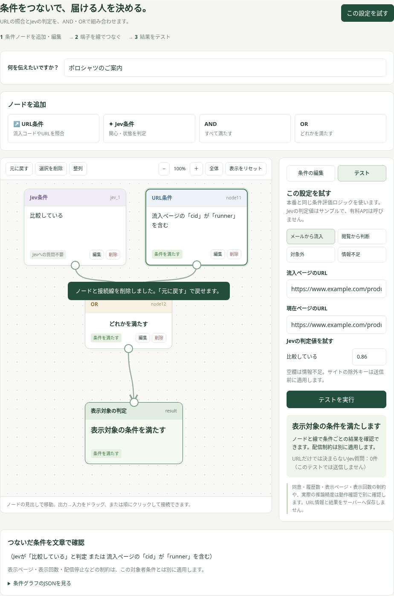
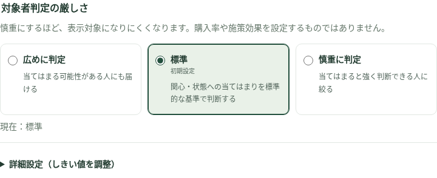
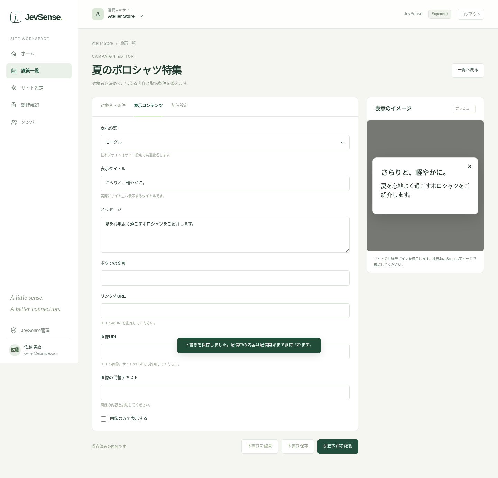

# Create and deliver campaigns

"Campaign list (「施策一覧」)" shows your campaigns, including stopped ones and drafts. From "New campaign (「新しい施策」)", you set the audience, the display content and the delivery settings, in that order. You need at least the editor permission.

## 1. Name the campaign

The campaign name is for administration. It is separate from the "display title" shown on the site. For example, call it "Summer polo shirt feature".

## 2. Edit condition nodes

Both when creating and when editing again, you set things on a screen where nodes are connected by lines. At first, one Jev condition is connected to the final result. Enter values with a node's "Edit", and apply them to the diagram with "Save changes (「変更を保存」)". You can also edit directly from "Edit conditions (「条件の編集」)" on the right.



### Judge an interest or state with Jev

In "What do you want to tell them? (「何を伝えたいですか？」)", write what you want to present.

> Introduce the feature on moisture-wicking polo shirts

In "Who do you want to reach? (「どんな人に届けたいですか？」)", write the one interest or state you want to judge.

> Interested in polo shirts with moisture-wicking function

Each is limited to 400 characters. Describe the context for judging, not product images or display HTML.

## 3. Check the actual question

Your input is fitted into a fixed template and shown. No text conversion by generative AI is performed. The question is sent to Jev in Japanese, as shown below.

```text
今回案内する内容：吸汗速乾ポロシャツの特集を案内する
現在ページ・流入ページ・有効な過去の閲覧履歴と連携された行動・状態の情報に基づき、この閲覧者に「吸汗速乾機能のあるポロシャツに関心がある」が当てはまりますか？
```

In English, it reads: "What to present this time: Introduce the feature on moisture-wicking polo shirts. Based on the current page, the entry page, the valid past browsing history and the linked actions and state, does 'Interested in polo shirts with moisture-wicking function' apply to this visitor?"

If it doesn't match your intent, fix your input. Don't write something vague like "a good person" or "likely to buy". Write what they are interested in and what state you want to judge.

| Field      | What to present                         | Interest or state to judge                         |
| ---------- | --------------------------------------- | -------------------------------------------------- |
| B2B        | A guide to sharing customer information | Has trouble sharing information across departments |
| Media      | An article feature on saving energy     | Interested in energy-saving measures for homes     |
| Recruiting | An information session on the dev team  | Interested in engineers' development environment   |
| Education  | An information session for beginners    | Interested in study plans for beginners            |

## Connect conditions

From "Add node (「ノードを追加」)", add URL conditions, Jev conditions, AND and OR. The output is the round terminal at the bottom of a node, and the input is the one at the top. Connect by dragging from an output to an input, or by clicking the output and then the input. Grab the heading to move a node.

- **URL condition**: checks the URL and GET parameters of the current page and entry page in code.
- **Jev condition**: judges one interest or state with Yes/No. It doesn't refer to the answer to another question.
- **AND**: true when all connected conditions are met.
- **OR**: true when any of the connected conditions is met.
- **Display decision**: the final result. It takes one input, and this node can't be deleted.

For example, "the email entry code contains runner, or interested in polo shirts" connects a URL condition and a Jev condition to OR, and connects the OR output to the final result. If you also make "comparing before buying" required, connect the OR result and another Jev condition to AND.

A branch where the URL alone settles the result doesn't ask Jev. For example, if the URL condition under OR is met, inferring the other interest isn't needed. Even when Jev is asked, the questions needed for the result are bundled into one request. AND/OR is evaluated by comparing each question's judgment score with the threshold, and probabilities are not multiplied together.

AND and OR need at least two inputs. A line that makes a loop can't be connected. To start delivery, every node must be connected to the final result. Per campaign, you can have up to 5 Jev questions, 5 URL conditions, and 20 nodes and 40 connections in total. Across the whole site, the limit is 10 Jev questions.

### Edit and delete

Delete a node with "Delete" or from the right-click menu. Click a line and press "Delete selection (「選択を削除」)" to remove only the connection. "Undo (「元に戻す」)" reverts the last change. The Delete key also works. If moving makes the diagram hard to read, adjust it with "Arrange (「整列」)" or "Fit (「全体」)".

### Try the conditions with a sample

Press "Test these settings (「この設定を試す」)" to check each node and the final result with the URLs you enter and provisional Jev scores. It doesn't call the Jev API, and usage counts and browsing history don't increase.

1. Enter the entry page URL and the current page URL. Use URLs within the registered origins and collected paths.
2. For each Jev condition, enter a provisional score from 0 to 1. Leave it blank for insufficient information.
3. Press "Run test (「テストを実行」)". You see "Target", "Not target" or "Insufficient information", and how many questions would need to be sent to Jev.

The site's excluded keys are removed from the URL before sending, and the API checks again. If you change a condition, URL, score or threshold, test again.

This test checks how the conditions combine. Jev's actual inference, the limits on consent, history count, delivery pages and display count, and how the offer looks are checked separately in [verification and preview](./testing). The scores in the input fields are not purchase rates or measured results.

## How strictly to judge the audience

Choose "Audience judgment strictness (「対象者判定の厳しさ」)" from three levels. The default is "Standard".

| Choice   | Meaning                                                         | Internal threshold |
| -------- | --------------------------------------------------------------- | ------------------ |
| Broad    | Also reaches people who may apply                               | 0.6                |
| Standard | Judges how well the interest or state applies by a standard bar | 0.7                |
| Careful  | Narrows to people judged to apply strongly                      | 0.85               |



The more careful you are, the harder it is to become a target. It isn't a setting for purchase rate or campaign effect. Other delivery conditions also limit display.

To fine-tune, open "Advanced settings (adjust the threshold) (「詳細設定（しきい値を調整）」)" and use the slider or numeric input. If an existing value matches none of the three levels, the details are shown as "Custom setting (「カスタム設定」)" and that value is kept. It is never rounded to a choice automatically.

The threshold ranges from 0.5 to 0.99. A visitor is a target when the judgment score is **above** the set value. For example, with a threshold of 0.70 and a score of exactly 0.70, the visitor is not a target.

## 4. Prepare the display content

Choose a type and set the display title, message, button, link and image. Details are in [display types](./presentation).



## 5. Delivery settings

| Item                        | Meaning                                                             |
| --------------------------- | ------------------------------------------------------------------- |
| Pages to display on         | All permitted pages, exact match or prefix match. Specified by path |
| Display count limit         | The limit within the browser's valid history                        |
| Priority                    | When several apply, the larger value wins                           |
| Confirmed states to exclude | Excluded if a registered fact is true                               |

If you specify an excluded state, a visitor is not treated as a target while the value is unknown. Pass it explicitly from the [SDK](../integration/sdk): false while incomplete, true once complete.

## 6. Save a draft and start delivery

**Save draft** saves what you are editing. Even if you edit a campaign that is live, the previous delivery content stays in place. You can save partial input too.

Press "Review delivery content (「配信内容を確認」)", check the content, then press "Start delivery with this content (「この内容で配信開始」)" to apply it to the live settings. You can't start if a judgment condition or display title is empty.

Before delivering, check on a real page from [Preview](./testing) in the list. You stop and resume from the list.

## If a concurrent edit conflicts

To avoid overwriting someone else's change, saving or delivering outdated edits is not accepted. Reload the list and check the latest content. Note down the input you need, discard your draft, and edit again from the latest content.

## Existing campaigns and JSON editing

When you open an existing campaign, the registered URL conditions and questions are shown as nodes, keeping their original AND/OR meaning. Question IDs, original text and the presented content are kept, and delivery settings don't change until you save. You can edit a custom question in "Judgment question (original text) (「判定質問（原文）」)". The original text doesn't change automatically when you change the shared presented content.

"View condition graph JSON (「条件グラフのJSONを見る」)" shows the saved format, and "Edit as JSON (「JSONで編集」)" lets you copy, paste and edit directly. "Apply JSON (「JSONを反映」)" validates IDs, connection targets and loops. Invalid JSON never replaces the diagram. To deliver, you still need to "Save draft" and "Review delivery content" separately.

## Narrow the audience by URL conditions

A "URL condition" node can use the GET parameters or the whole URL of the current page or entry page as the condition. For example, to identify entries from an email, set it up like this.

| Item              | Example setting                          |
| ----------------- | ---------------------------------------- |
| Target page       | Entry page (the first one after consent) |
| Value to check    | The value of a GET parameter             |
| GET parameter key | `cid`                                    |
| Match method      | Contains                                 |
| Value to compare  | `runner`                                 |

This condition doesn't ask Jev and is checked in code. GET parameters are compared against the decoded value and are case-sensitive. If the same key has several values, it is met when any one matches. Combine URL conditions with AND/OR nodes. Values in the site's excluded keys can't be used.

If you also want to infer an interest or state, connect a Jev condition with AND/OR. In a campaign where only URL conditions connect to the final result, neither the request to Jev nor the judgment threshold is used. If the URL or its parameters are missing, that condition is not met.

**Valid past views required for judging** is 0 for new campaigns. Set 0 if you want to display on the first visit with only an entry condition. For a campaign that needs past browsing, specify a count or use the site setting. The current page doesn't count as a past valid view. An existing campaign with no value keeps the site setting.
