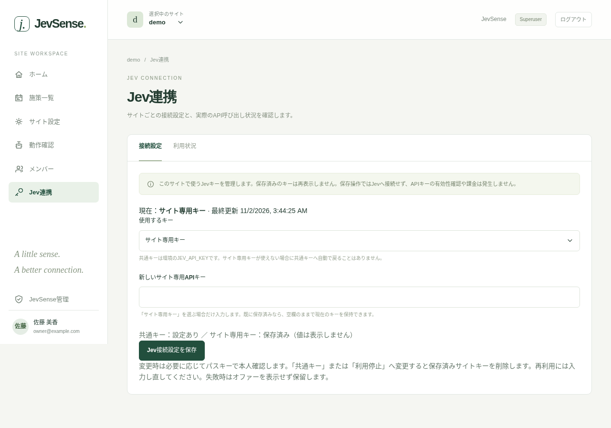
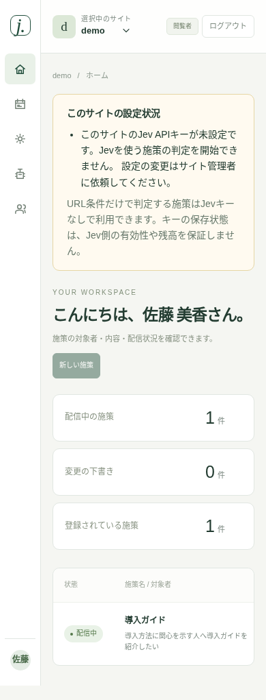
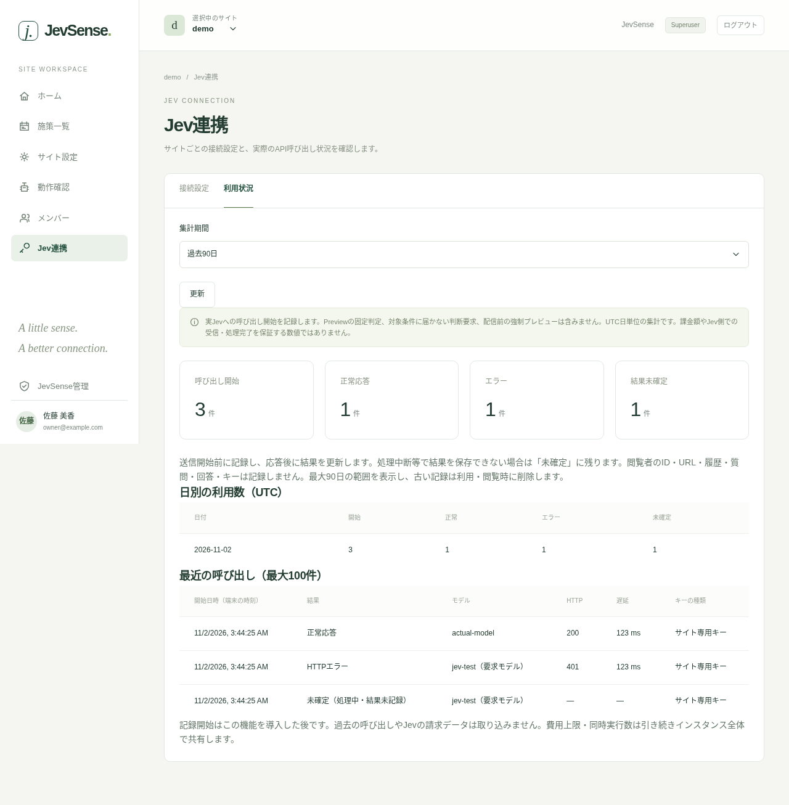

# Jev connection settings and usage

Select the target site and open "Jev connection (「Jev連携」)" in the left menu. Only site admins and superusers can use it. Key settings and usage records are not shown to editors or viewers.

## Set the key for each site

A Jev API key is registered per site ID. An instance-wide key is not used. New sites, and sites that used a shared key before, show "API key not set (「APIキー未設定」)".

| Key to use     | Behavior                                                    |
| -------------- | ----------------------------------------------------------- |
| Site-only key  | Uses the Jev API key saved for this site ID                 |
| Stop using Jev | Stops Jev judgments for this site and deletes the saved key |

1. Choose "Site-only key (「サイト専用キー」)".
2. Enter it in "New site-only API key (「新しいサイト専用APIキー」)".
3. Press "Save Jev connection settings (「Jev接続設定を保存」)" and confirm. Verify with your passkey if asked.

A saved value is never shown again. When you open it again the field is empty and only "Saved" is shown. If a site-only key already exists, saving with the field empty keeps the current value. Entering a new value replaces it. Saving doesn't connect to Jev, check validity or incur charges.

Saving a site-only key requires the environment administrator to complete the [initial setup of the encryption key](../operations/jev-keys). If it isn't set up, a message tells you so.

::: warning Switching the connection mode
Changing to "Stop using" deletes the saved site key. To go back, enter the key again. It does not revoke the key on the Jev side.
:::

If the key is not set, revoked or can't be decrypted, judgment is held. The keys of other sites are not used. Requests already in progress before the key change can't be cancelled.

The screen below is an example with test settings. No real API key is shown.

## Notices about the setup status

The admin console for the selected site shows what is not set or stopped, and where to fix it. Editors and viewers can also see what is missing, but only site admins and superusers can register or change keys and view usage records.

- **API key not set**: register a key from "Jev connection" for this site.
- **No encryption setup, or the key can't be read**: ask the environment administrator to check JEV_KEYRING.
- **Jev is stopped**: to resume, enter a site-only key again.
- **Metadata sending is disabled, or no campaign is being delivered**: check the site settings and the campaign list.

The status updates when you switch sites, reload the page or save. This notice alone can't confirm that the SDK tag is placed or that users have consented. Check those from "Verification". A "saved" indicator for the key doesn't guarantee validity or balance on the Jev side. No Jev request is made to check them. A judgment settled by the URL alone works without a key, even for a campaign that contains Jev conditions. If an unsettled Jev condition remains, the site needs a registered key. Preview's fixed-value judgment does not connect to the real Jev.

## View usage

Open "Usage (「利用状況」)", choose the past 7, 30 or 90 days and press "Refresh (「更新」)". Totals are by UTC day. It shows daily counts, plus the latest 100 results, model names, HTTP status, latency and key type. Records from the retired shared key are shown as "Shared key (retired)", and new calls use only site-only keys. This is the whole site's record, including before and after key changes. There is no automatic polling.

| Display              | Meaning                                                                                                                 |
| -------------------- | ----------------------------------------------------------------------------------------------------------------------- |
| Calls started        | The number of times the start of a Jev API call was recorded                                                            |
| Successful responses | The number of times the HTTP response and basic data format were normal. Not the number that met the display conditions |
| Errors               | HTTP failures, timeouts, communication failures and malformed response formats                                          |
| Result unconfirmed   | Records whose result isn't settled because they are in progress, interrupted or failed to save                          |

Not every decision request from a browser reaches Jev. Unmet conditions, exceeding the budget, a missing key, a stop, fixed judgments in Preview/local-review and forced previews before delivery are not counted. History from before this feature was introduced is not shown either.

The counts, results, models and latency in the example screen are artificial data created to verify the UI. They are not measurements from Jev.

## Counts versus billing

A record is made before sending starts and its result is updated after the response. An interruption in between can leave a start row even though nothing was actually sent, or leave a result unconfirmed even though it was sent. It is not a counter that guarantees the number of requests Jev received, the number billed or the amount.

**Check billing and consumption on the Jev (TypeSafe) side.** Whether a failed request is billed also follows the provider's rules. A successful response doesn't mean a purchase or campaign success, and latency is Jev's HTTP processing time, not the total time until the display.

The cost limit and concurrency are shared across the whole instance, even when site-only keys are used. A per-site budget limit is not part of this release.

## What is not recorded

Key values or fragments, visitor IDs, IPs, URLs, history, state, questions, answers, probabilities and request/response bodies are not kept. Only operational metadata about the call is stored. Records are shown for up to 90 days, and old rows are deleted when the feature is used or viewed. Records inside backups are managed under a separate retention policy.

With Preview's fixed judgment, entering a key doesn't confirm actual validity or the connection to Jev, and the usage count doesn't increase. If you want to try a real connection, check with the environment administrator and do it separately, as a request that will be billed.
