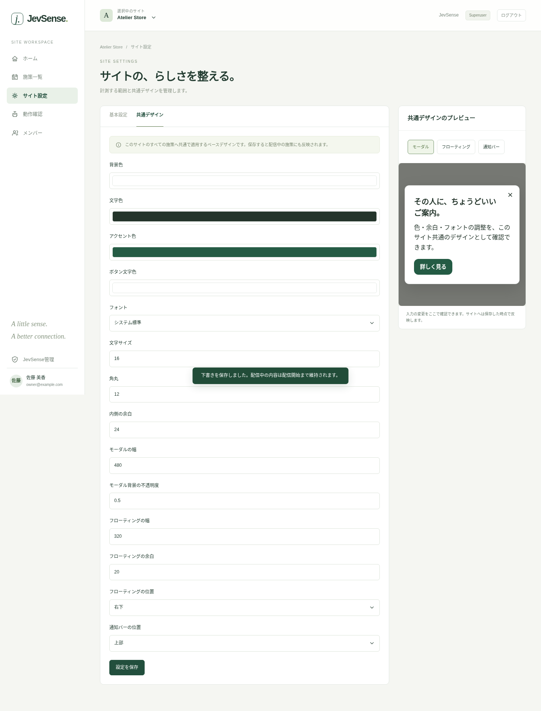

# Site settings and shared design

Select the target site in the header and open "Site settings (「サイト設定」)". Site admins and superusers can change them. Adding a new site is done by a superuser in "JevSense management (「JevSense管理」)".

## Basic settings

| Item                          | Example and meaning                                                             |
| ----------------------------- | ------------------------------------------------------------------------------- |
| Site name                     | The name used in the admin console. Can be changed later                        |
| Site ID                       | Matches `data-site` in the SDK. Can't be changed after creation                 |
| Allowed origins               | `https://example.com`. No path and no trailing slash                            |
| Paths to collect              | `/ja/`. Prefix match, one per line                                              |
| Paths not to collect          | `/ja/account`, `/ja/checkout`, `/ja/search` and so on                           |
| Metadata sending              | Enable it after you've checked the information on the target pages              |
| Display time for a valid view | In milliseconds. The threshold for excluding very short views from the evidence |
| Valid views required          | The number of valid page views needed before judging starts                     |

A newly created site has sending and campaigns disabled. Check the settings and choose "Save settings (「設定を保存」)". After you change what is collected, reload the target pages so the SDK picks up the new settings.

### Origin versus path

An example for targeting `https://adobe.customer-experience.dev/ja/`.

- Origin: `https://adobe.customer-experience.dev`
- Path to collect: `/ja/`
- Page to display on: on the campaign side, for example an exact match of `/ja/`

What you collect and where you display are separate. You can collect product pages as evidence and show the message only on the home page.

## Additional events and states

Register event names and state names only when you integrate your own clicks, applications, bookings, carts and similar. The SDK accepts only registered names. See [optional integrations](../integration/sdk#optional-events-and-states).

## The site's shared basic design

"Shared design (「共通デザイン」)" sets the look applied to all standard campaigns of that site.

| Target           | What you can adjust                                                         |
| ---------------- | --------------------------------------------------------------------------- |
| Common           | Background, text and button colors, font, font size, corner radius, spacing |
| Modal            | Width, darkness of the backdrop                                             |
| Floating         | Width, bottom right or bottom left, margin from the screen edge             |
| Notification bar | Top or bottom                                                               |

You can switch the display type in the preview on the right while you check. Changes you are typing don't reach the site until you save. Saving also applies to campaigns that are already being delivered.

## Allowing custom JavaScript

This is allowed per site. Only site admins or superusers can create, change and preview code. Code runs with the same privileges as your site, so register only code you trust. Also read [display types and custom code](./presentation).

## Jev connection per site

Set the site-only API key and the usage stop in [Jev connection (「Jev連携」)](./jev) in the left menu. You don't need to write the key into the site settings JSON or the SDK tag. Only site admins and superusers can operate it and view usage records.

## Fetching page information and checking on a real page

The "Page information fetching (「ページ情報の取得」)" tab sets how this site fetches information in common. Site admins and superusers can change it.

1. Choose **standard automatic fetching** or **site-specific rules**. Standard takes the page name in the order OGP → title, and the description in the order OGP → meta description. Choose custom if you use JSON-LD.
2. With custom, arrange candidates from the top. Use "Edit" to set the conditions, the source and key for the page name and description, a prefix, and how to handle a missing description. Conditions are evaluated against the same JSON-LD object.
3. In **Page URL to check** on the right, enter a URL within the registered site and the paths to collect, and press **Check with this URL**.
4. On the real page in the other tab, complete the measurement consent if needed. The admin console then shows the page name, description, the candidate used and the reasons for rejected ones. You can check even an unsaved draft of the settings.
5. If everything looks right, press **Review changes → Save**.

A check is valid for 5 minutes. It needs the latest SDK and metadata sending enabled in the basic settings. Normal Jev judgment, offer display and saving browsing history are not performed. The permission for checking is limited to this admin session, site and URL, and the connection can be started only once.

If the meta information changes on the page, the result updates too. **Fetch again from the same page** also rechecks. When you change the draft settings, the old result is cleared and the checking connection is ended. To check with the changed content, press **Check with this URL** again.

If it can't connect, check the tag placement and update, completion of consent, CSP, allowing pop-ups and Cross-Origin-Opener-Policy. On a site where COOP cuts the connection with the other tab, this way of checking isn't available. Before introducing the SDK, or when it can't connect, you can try only the rules with the collapsed artificial data input. It is shown separately from real-page measurement.

For an existing site with no fetching settings, the previous JSON-LD-first behavior continues until you switch and save. After saving, it applies the next time the SDK fetches its settings. Browsing history from before the change is discarded, and the displayed state is kept. For the fetched keys and their priority, see [data collected and sent](../integration/data).

## Keys excluded from URL collection

At the top of "Page information fetching", enter the **GET parameter keys not to collect**, one per line. For example, if you specify `email` and `token`, those keys and values are removed from the URLs of the current page, the entry page and the valid view history. GET parameters you don't specify are kept.

If you enter a URL to check on the right, you can see the URL that would be saved and sent right there. This display alone doesn't communicate externally. The exclusion setting can be saved in standard, custom or legacy metadata mode. Once you save it from "Review changes", it applies the next time the settings are loaded. It isn't reflected immediately in another tab that is still open.

Keys are case-sensitive and are matched exactly after URL decoding. If the same key appears several times, all of them are removed. The limit is 50 keys of up to 100 characters each. For details, see [data collected and sent](../integration/data#page-url-and-excluded-keys).
