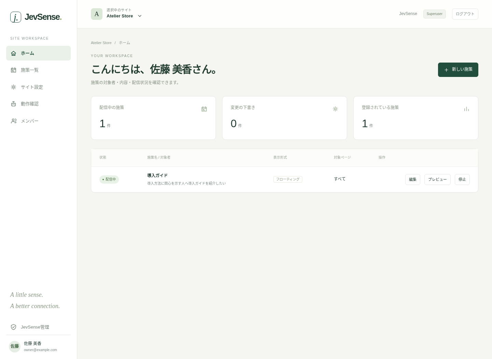

## Find what you need

| What you want to do                          | Page to read                                                                      |
| -------------------------------------------- | --------------------------------------------------------------------------------- |
| See what JevSense can do                     | [What is JevSense?](./introduction/overview)                                      |
| Create a campaign after being invited        | [Sign-in and accounts](./guides/accounts), [Create campaigns](./guides/campaigns) |
| Install it in your own environment           | [Set up on Cloudflare](./getting-started/cloudflare)                              |
| Find out why something isn't being displayed | [Diagnostic panel](./guides/debugging), [Troubleshooting](./troubleshooting)      |
| Check in Preview, then release to production | [From Preview to Production](./getting-started/preview-production)                |

