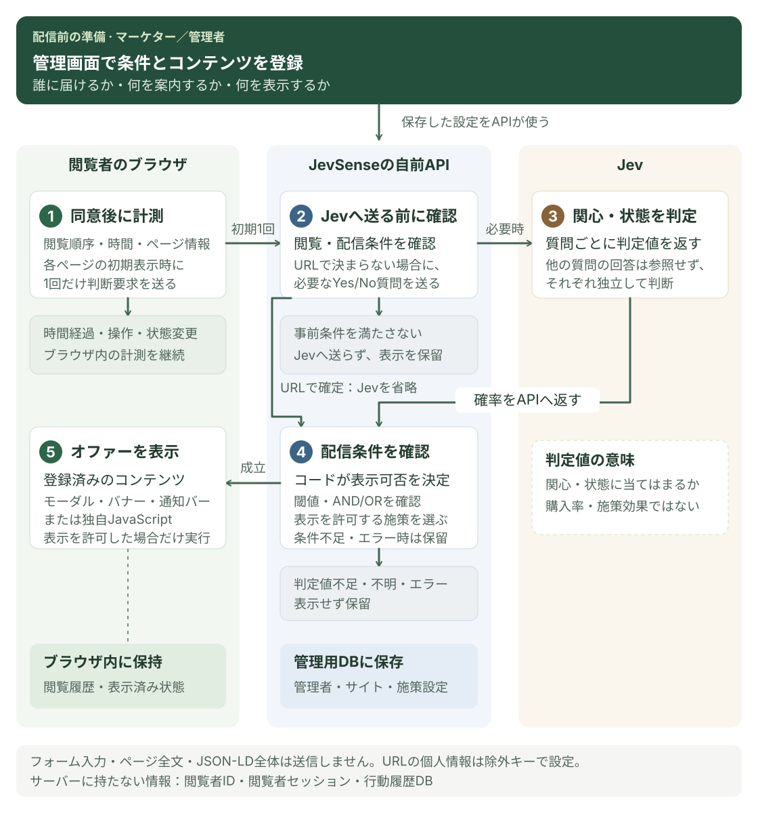

# What is JevSense?

JevSense is a web personalization platform. It judges a visitor's interests and state from how they browse, then shows a prepared message at the right moment. You run it in your own Cloudflare or Node.js environment.

::: tip About the admin console language
The admin console is currently available in Japanese only. In this Help, screen labels appear as an English translation followed by the original Japanese label in 「 」, for example "Help and manual (「ヘルプ・マニュアル」)".
:::

## Where it fits

| Site type  | Example                                                                          |
| ---------- | -------------------------------------------------------------------------------- |
| E-commerce | Point people interested in functional apparel to a feature page                  |
| B2B        | Introduce an onboarding guide to people interested in adoption and operations    |
| Media      | Suggest related articles to people who keep reading about a specific topic       |
| Recruiting | Invite people interested in your development environment to an engineering event |
| Education  | Suggest an information session to people interested in how to study              |
| Booking    | Offer a consultation desk to people considering a plan                           |

The text, images, links and JavaScript to display are prepared in advance by an administrator.

## How decisions are made

In the admin console you set the audience conditions and the message to show, and register the content to display. JevSense does not ask Jev on every measurement. Measuring in the browser, asking the API for a decision and asking Jev each have their own conditions for moving on to the next step.

[Open the diagram in full size](/images/system-workflow.svg). On a smartphone you can scroll the diagram horizontally. The diagram's labels are in Japanese.

1. After consent, the shared SDK observes browsing order, display time and page information.
2. Once, when a page opens, it sends the current and entry pages and the past valid views to your own API. Reaching the minimum viewing time and changes in actions or state are stored in the browser and used for the initial decision on the next page.
3. The API checks things such as valid views and target campaigns. Only when the conditions are met does it send Jev the state and independent Yes/No questions.
4. When the judgment score comes back, code checks the threshold, AND/OR and display constraints.
5. Only when display is allowed does it return the registered content, and the SDK shows it on the page.

The flow can also end earlier in one of these ways.

- **Measure only**: time passing or actions after the initial decision only update the record in the browser.
- **Held at the API**: if viewing time is too short or there is no target campaign, nothing is sent to Jev. A missing key or a cost limit also stops the request.
- **Held after asking Jev**: nothing is displayed if the score does not reach the threshold, the judgment is uncertain, or there is a communication or response problem.

URL and Jev conditions are combined by connecting nodes with AND/OR. If the URL alone settles the result, the request to Jev is skipped even for a campaign that contains Jev conditions. Only the questions that need inference are bundled into one request, and the remaining conditions are evaluated from the answer. See [Create campaigns](../guides/campaigns) for details.

## How it differs from generative AI

Jev is used to judge the audience. It is not used to generate text, images or HTML. The input assistance in the admin console also just fits the sentence you typed into a fixed question template.

The judgment score is evidence for "does this interest or state apply?". It does not guarantee purchase rate, campaign effect or future behavior.

## Where to start, by role

**If you build campaigns**, accept an invitation from an administrator, register your [account](../guides/accounts) and [create campaigns](../guides/campaigns). You don't need to install a development environment.

**If you install it**, set up [Cloudflare](../getting-started/cloudflare) or [Node.js](../getting-started/node), then place the [SDK tag](../integration/sdk).

**If you operate it**, read [permissions and secrets](../operations/security) and [updates and recovery](../operations/maintenance).

## Data that is stored

The visitor's history and the displayed state are kept in the browser. No visitor ID, visitor session or behavior-history database is added on the server.

An administrator's account, passkey public key, memberships and campaign settings are stored in the admin database. That does not mean nothing is sent externally, so please also read [data collected and sent](../integration/data).
