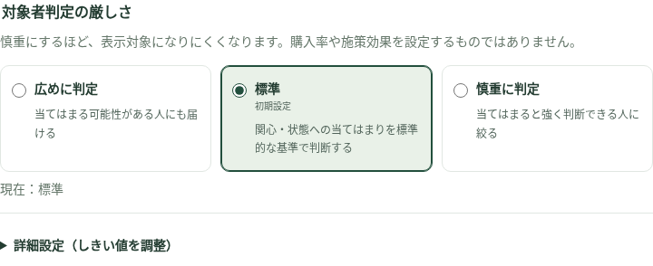
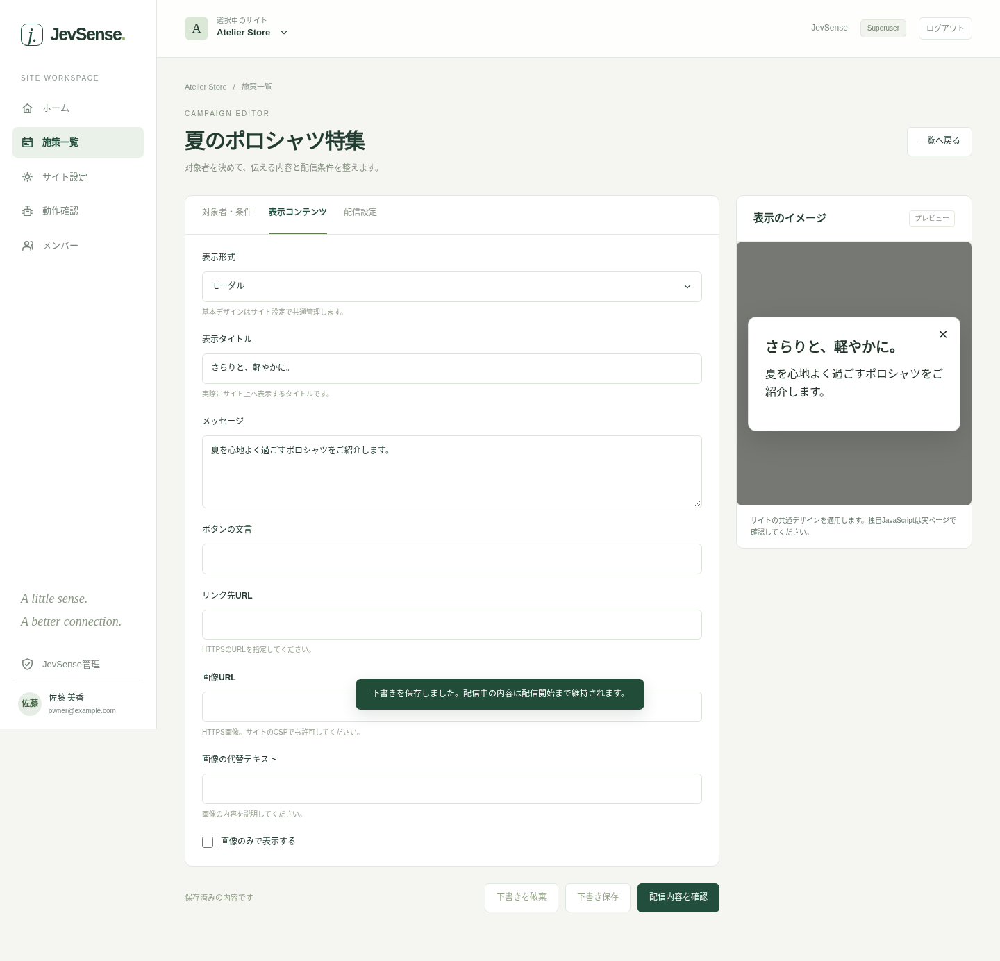

# 施策を作成・配信する

「施策一覧」で、停止中・下書きを含む施策を確認できます。「新しい施策」から、対象者、表示内容、配信設定の順に設定します。編集者以上の権限が必要です。

## 1. 施策名を付ける

施策名は管理用です。サイト上の「表示タイトル」とは別です。例として「夏のポロシャツ特集」と付けます。

## 2. 案内する内容と対象者を入力する

「何を伝えたいですか？」には案内する内容を書きます。

> 吸汗速乾ポロシャツの特集を案内する

「どんな関心・状態に当てはまる人ですか？」には判断したい1つの関心・状態を書きます。

> 吸汗速乾機能のあるポロシャツに関心がある

どちらも各400文字以内です。商品画像や表示用HTMLではなく、判定の文脈を説明します。

## 3. 実際の質問を確認する

入力を固定の型に当てはめて表示します。生成AIによる文章変換は行いません。

```text
今回案内する内容：吸汗速乾ポロシャツの特集を案内する
閲覧履歴と連携された行動・状態の情報に基づき、この閲覧者に「吸汗速乾機能のあるポロシャツに関心がある」が当てはまりますか？
```

意図に合わない場合は入力文を修正します。漠然とした「よさそうな人」「買ってくれそう」ではなく、何に関心があるか、どんな状態を判断したいかを書いてください。

| 分野     | 案内する内容             | 判定する関心・状態               |
| -------- | ------------------------ | -------------------------------- |
| BtoB     | 顧客情報共有の導入ガイド | 複数部門での情報共有に課題がある |
| メディア | 省エネ対策の記事特集     | 家庭向けの省エネ対策に関心がある |
| 採用     | 開発組織の説明会         | エンジニアの開発環境に関心がある |
| 教育     | 初学者向け説明会         | 初心者向けの学習計画に関心がある |

## 複数の条件

「判定する関心・状態を追加」で分けます。1問につき1つの判断を聞き、別の質問の回答は参照しません。

- AND：すべての質問が条件を満たす場合。
- OR：いずれかの質問が条件を満たす場合。

ページの完全一致や表示回数、応募済み等の確定状態は、質問へ埋め込まず配信設定で扱います。

## 対象者判定の厳しさ

「対象者判定の厳しさ」は、次の3段階から選びます。初期設定は「標準」です。

| 選択肢     | 意味                                             | 内部のしきい値 |
| ---------- | ------------------------------------------------ | -------------- |
| 広めに判定 | 当てはまる可能性がある人にも届ける               | 0.6            |
| 標準       | 関心・状態への当てはまりを標準的な基準で判断する | 0.7            |
| 慎重に判定 | 当てはまると強く判断できる人に絞る               | 0.85           |



慎重にするほど表示対象になりにくくなります。購入率や施策効果を設定するものではありません。他の配信条件によっても表示は制限されます。

細かく調整する場合は「詳細設定（しきい値を調整）」を開き、スライダーまたは数値入力を使います。既存の値が3段階のどれにも一致しない場合は「カスタム設定」として詳細を表示し、その値を保持します。選択肢へ自動で丸めることはありません。

しきい値は0.5〜0.99です。判定値が設定値を**上回る**場合に対象とします。たとえばしきい値0.70で判定値がちょうど0.70なら対象になりません。

## 4. 表示コンテンツを用意する

形式を選び、表示タイトル・メッセージ・ボタン・リンク・画像を設定します。[表示形式](./presentation)に詳細をまとめています。



## 5. 配信設定

| 項目             | 意味                                         |
| ---------------- | -------------------------------------------- |
| 表示するページ   | 全許可ページ、完全一致、前方一致。パスで指定 |
| 表示回数の上限   | ブラウザの有効な履歴内の上限                 |
| 優先順位         | 複数対象の場合、大きい値を優先               |
| 除外する確定状態 | 登録済みfactがtrueなら除外                   |

除外状態を指定した場合、値が不明なまま対象とは扱いません。未完了ならfalse、完了したらtrueを[SDK](../integration/sdk)から明示して連携します。

## 6. 下書き保存と配信開始

**下書き保存**では編集中の内容を保存します。公開中の施策を編集しても、以前の配信内容は維持します。途中の入力も保存できます。

「配信内容を確認」を押し、内容を確認してから「この内容で配信開始」を押すと、公開設定へ反映されます。未入力の判定条件や表示タイトルがあれば開始できません。

配信前は一覧の[プレビュー](./testing)から実ページで確認してください。停止・再開は一覧から行います。

## 同時編集で競合した場合

別の変更を上書きしないよう、古い編集内容の保存・配信は受け付けません。一覧を読み直し、最新の内容を確認します。必要な入力を控えたうえで下書きを破棄し、最新内容から編集し直してください。

既存の手動質問は保持します。「入力支援に切り替える」を選んだときだけ新しい入力方法へ変更します。
