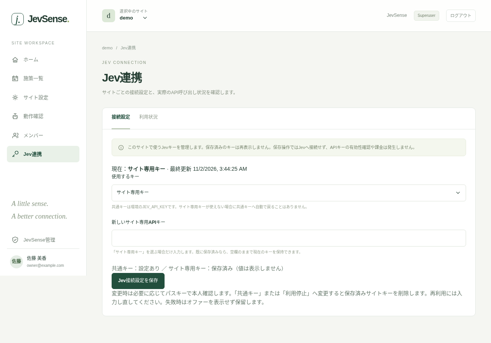
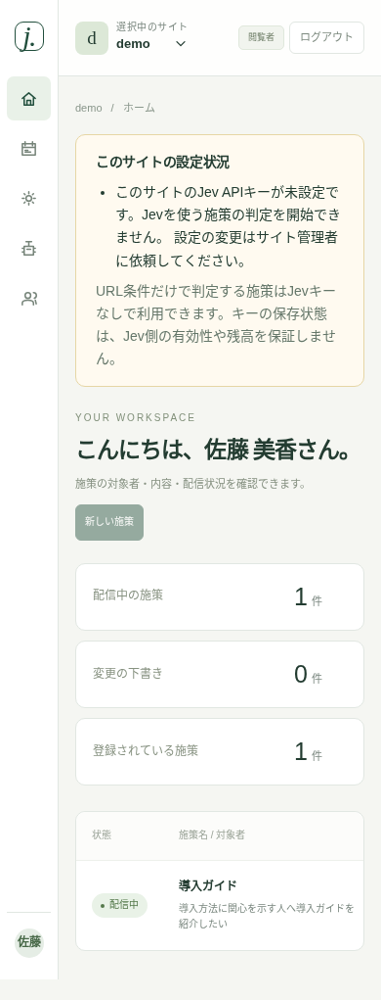
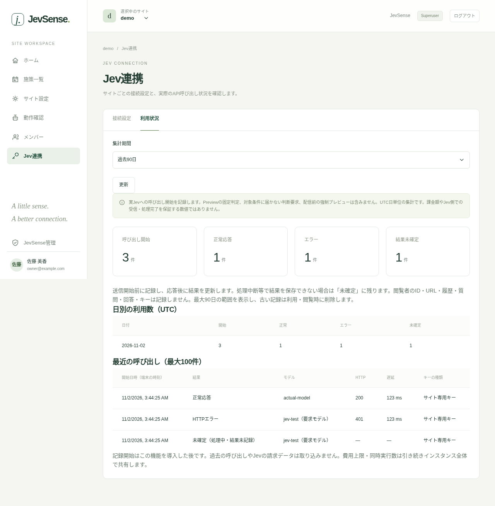

# Jevの接続設定と利用状況

対象サイトを選び、左メニューの「Jev連携」を開きます。サイト管理者とSuperuserだけが利用できます。編集者・閲覧者にはキー設定・利用記録を公開しません。

## サイトごとのキーを設定する

Jev APIキーはサイトIDごとに登録します。インスタンス共通キーは使いません。新しいサイトと、以前に共通キーを使っていたサイトは「APIキー未設定」になります。

| 使用するキー    | 動作                                                |
| --------------- | --------------------------------------------------- |
| サイト専用キー  | このサイトIDに保存したJev APIキーを使う             |
| Jevの利用を停止 | このサイトのJev判定を停止し、保存済みキーを削除する |

1. 「サイト専用キー」を選ぶ。
2. 「新しいサイト専用APIキー」へ入力する。
3. 「Jev接続設定を保存」を押して確認する。必要に応じてパスキーで本人確認する。

保存済みの値は再表示しません。再度開くと空欄になり、「保存済み」とだけ表示されます。既に専用キーがある場合、空欄で保存すると現在値を保持します。新しい値を入力すると置き換わります。保存操作ではJevへの接続・有効性確認・課金を行いません。

専用キーの保存には、環境管理者による[暗号化キーの初期設定](../operations/jev-keys)が必要です。未設定の場合は案内が表示されます。

::: warning 接続モードの切り替え
利用停止へ変更すると、保存済みサイトキーを削除します。元に戻す場合はキーを入力し直してください。Jev側のキーを失効する操作ではありません。
:::

キーが未設定・失効・復号不能の場合は判定を保留します。他サイトのキーは使いません。キー変更前から進行している要求は取り消せません。

以下はテスト用の設定による画面例です。実際のAPIキーは表示していません。

## 設定状況の通知

選択中サイトの管理画面には、未設定や停止の内容と対応先を表示します。編集者・閲覧者も不足内容を確認できますが、キーの登録・変更と利用記録の閲覧はサイト管理者・Superuserだけが行えます。

- **APIキー未設定**：このサイトの「Jev連携」からキーを登録してください。
- **暗号化設定がない・キーを読み出せない**：環境管理者にJEV_KEYRINGを確認してもらいます。
- **Jevの利用を停止中**：再開する場合は専用キーを入力し直します。
- **メタデータ送信が無効・配信中の施策なし**：サイト設定と施策一覧で確認します。

状態はサイト切り替え・ページ再読み込み・保存後に更新します。SDKタグの設置や利用者の同意は、この通知だけでは確認できません。「動作確認」から確認してください。キーの保存済み表示は、Jev側の有効性や残高を保証しません。確認のためのJev問い合わせは行いません。URLだけで結論が出る判定は、Jev条件を含む施策でもキーなしで利用できます。未確定のJev条件が残る場合は、サイトのキー登録が必要です。Previewの固定値判定は実Jevへ接続しません。

## 利用状況を見る

「利用状況」を開き、過去7日・30日・90日を選んで「更新」を押します。集計はUTC日単位です。日別件数と最近100件の結果・モデル名・HTTP status・遅延・キーの種類を表示します。廃止前の共通キーによる記録は「共通キー（廃止済み）」と表示し、新しい呼び出しはサイト専用キーだけを使います。キーの変更前後を含むこのサイト全体の記録です。自動ポーリングは行いません。

| 表示         | 意味                                                                       |
| ------------ | -------------------------------------------------------------------------- |
| 呼び出し開始 | Jev APIの呼び出し開始処理を記録した数                                      |
| 正常応答     | HTTPの応答と基本的なデータ形式が正常だった数。表示条件に合致した数ではない |
| エラー       | HTTP失敗・タイムアウト・通信失敗・応答形式不正                             |
| 結果未確定   | 処理中・処理の中断・結果の保存失敗のいずれかで、結果が確定していない記録   |

ブラウザからの判断要求がすべてJevへ進むわけではありません。条件未達、予算超過、キー未設定、停止、Preview/local-reviewの固定判定、配信前の強制プレビューは件数に含みません。新機能を導入する前の履歴も表示しません。

画面例の件数・結果・モデル・遅延は、UI検証用に作成した人工データです。Jevの実測ではありません。

## 件数と課金の違い

送信開始前に記録し、応答後に結果を更新します。その間の中断では、実際の送信前でも開始行が残ったり、送信済みでも未確定になったりします。Jev側が受信した件数・課金件数・金額を保証するカウンターではありません。

**課金や消費量はJev（TypeSafe）側で確認してください。** 失敗した要求の課金有無も提供元のルールに従います。正常応答は購入・施策成功を意味せず、遅延はJevのHTTP処理時間で、画面表示までの全時間ではありません。

費用上限と同時実行数は、専用キーを使う場合もインスタンス全体で共有します。サイト別の予算上限は今回の機能に含みません。

## 記録されないもの

キーの値・断片、閲覧者ID・IP・URL・履歴、state、questions、回答、確率、要求/応答本文は残しません。保存対象は呼び出しの運用メタデータだけです。記録は最大90日の範囲で表示し、古い行は利用・閲覧のタイミングで削除します。バックアップ中の記録は別の保持方針で管理します。

Previewの固定判定では、キーを入力しても実際の有効性やJevとの接続は確認できず、利用件数は増えません。実接続を試す場合は環境管理者と確認し、課金される要求として別途実施してください。
