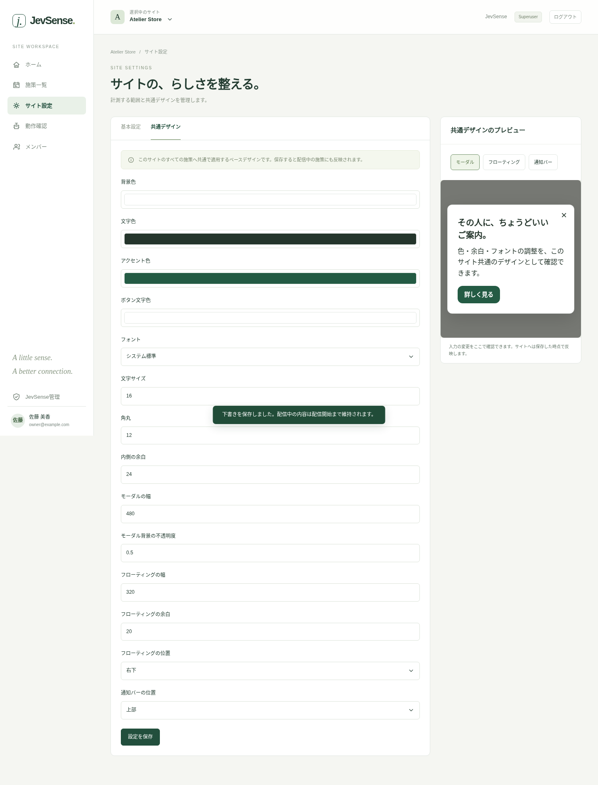

# サイト設定と共通デザイン

ヘッダーで対象サイトを選び、「サイト設定」を開きます。サイト管理者またはSuperuserが変更できます。新しいサイトの追加はSuperuserが「JevSense管理」で行います。

## 基本設定

| 項目                 | 入力例・意味                                  |
| -------------------- | --------------------------------------------- |
| サイト名             | 管理画面で使う名前。後から変更可能            |
| サイトID             | SDKのdata-siteと一致。作成後は変更不可        |
| 許可するオリジン     | https://example.com。パス・末尾スラッシュなし |
| 収集する経路         | /ja/。前方一致、1行に1つ                      |
| 収集しない経路       | /ja/account、/ja/checkout、/ja/search等       |
| メタデータ送信       | 対象ページの情報を確認してから有効化          |
| 有効な閲覧の表示時間 | ミリ秒。短時間表示を判断材料から除く基準      |
| 必要な有効閲覧数     | 判定を始めるための有効ページ閲覧数            |

新設サイトは送信と施策が無効です。設定を確認して「設定を保存」します。収集範囲の変更後は対象ページを再読み込みし、SDKに新しい設定を読み込ませます。

### オリジンとパスの違い

`https://adobe.customer-experience.dev/ja/`を対象にする例です。

- オリジン：`https://adobe.customer-experience.dev`
- 収集する経路：`/ja/`
- 表示ページ：施策側で、たとえば完全一致`/ja/`

収集する範囲と表示するページは別です。商品ページを判断材料として集め、トップページだけに案内を表示できます。

## 追加イベントと状態

独自クリック・応募・予約・カートなどを連携する場合だけ、イベント名・状態名を登録します。SDKは登録済みの名前だけを受け付けます。[追加連携](../integration/sdk#任意のイベント・状態)を参照してください。

## サイト共通の基本デザイン

「共通デザイン」ではそのサイトの全標準施策へ適用する見た目を設定します。

| 対象           | 調整内容                                               |
| -------------- | ------------------------------------------------------ |
| 共通           | 背景・文字・ボタン色、フォント、文字サイズ、角丸、余白 |
| モーダル       | 幅、背面の暗さ                                         |
| フローティング | 幅、右下/左下、画面端との余白                          |
| 通知バー       | 上部/下部                                              |

右のプレビューで形式を切り替えながら確認できます。入力中の変更は保存するまでサイトへ反映しません。保存すると配信中の施策にも適用します。

## 独自JavaScriptの許可

サイト単位で許可します。コードの作成・変更・プレビューはサイト管理者またはSuperuserだけが行えます。コードはサイトと同じ権限で動くため、信頼できるものだけを登録します。[表示形式と独自コード](./presentation)も確認してください。

## サイトごとのJev接続

左メニューの[Jev連携](./jev)でサイト専用のAPIキーと利用停止を設定します。サイト設定JSONやSDKタグへキーを記入する必要はありません。操作と利用記録の閲覧はサイト管理者/Superuserだけが行えます。

## ページ情報の取得と実ページ確認

「ページ情報の取得」タブで、このサイト共通の取得方法を設定します。変更できるのはサイト管理者・Superuserです。

1. **標準の自動取得**か**サイト独自のルール**を選ぶ。標準はページ名をOGP → title、説明をOGP → meta descriptionの順に取得します。JSON-LDを使う場合はカスタムにします。
2. カスタムでは候補を上から並べる。「編集」で条件、ページ名・説明の取得元とキー、接頭辞、説明がない場合の扱いを設定します。条件は同じJSON-LDオブジェクトに対して評価されます。
3. 右側の**確認するページURL**へ、登録済みのサイト・収集経路にあるURLを入力し、**このURLで確認**を押す。
4. 別タブの実ページで、必要なら計測への同意を完了する。管理画面へページ名・説明・採用した候補・不採用理由が表示されます。保存前の設定案でも確認できます。
5. 問題がなければ**変更内容を確認 → 保存する**を押す。

確認は5分間有効です。最新版のSDKと、基本設定のメタデータ送信有効化が必要です。通常のJev判定・オファー表示・閲覧履歴保存は行いません。確認用の権限はこの管理者セッション・サイト・URLに限定し、接続開始に使えるのは1回です。

メタ情報がページ内で変わると結果も更新します。**同じページから再取得**でも再確認できます。設定案を変えると古い結果を消し、確認用の接続を終了します。変更後の内容で確認するには、もう一度**このURLで確認**を押してください。

接続できない場合は、タグの設置・更新、同意の完了、CSP、ポップアップの許可、Cross-Origin-Opener-Policyを確認します。COOPで別タブとの接続が切れるサイトは、この方式での確認を利用できません。SDK導入前や接続できない場合は、折り畳んだ人工データ入力でルールだけを試せます。実ページの測定とは区別して表示します。

既存サイトに取得設定がない場合は、切り替えて保存するまで従来のJSON-LD優先を維持します。保存後は次回SDKが設定を取得したときに適用します。変更前の閲覧履歴は破棄し、表示済み状態は保持します。取得キーと優先順位は[取得・送信されるデータ](../integration/data)を参照してください。

## URLの取得から除外するキー

「ページ情報の取得」の先頭で、**取得しないGETパラメータのキー**を1行ずつ入力します。例えば`email`・`token`を指定すると、それらのキーと値を現在・流入ページと有効閲覧履歴のURLから除きます。未指定のGETパラメータは保持します。

右側に確認したいURLを入力すると、保存・送信するURLをその場で確認できます。この表示だけでは外部へ通信しません。除外設定はメタデータの標準・カスタム・従来モードのいずれでも保存できます。「変更内容を確認」から保存すると、次の設定読み込み時に適用します。開いたままの別タブへ即時反映はしません。

キーは大文字小文字を区別し、URLデコード後の完全一致で照合します。同じキーが複数あればすべて除きます。最大50件・各100文字です。詳細は[取得・送信されるデータ](../integration/data#ページurlと除外キー)を参照してください。
