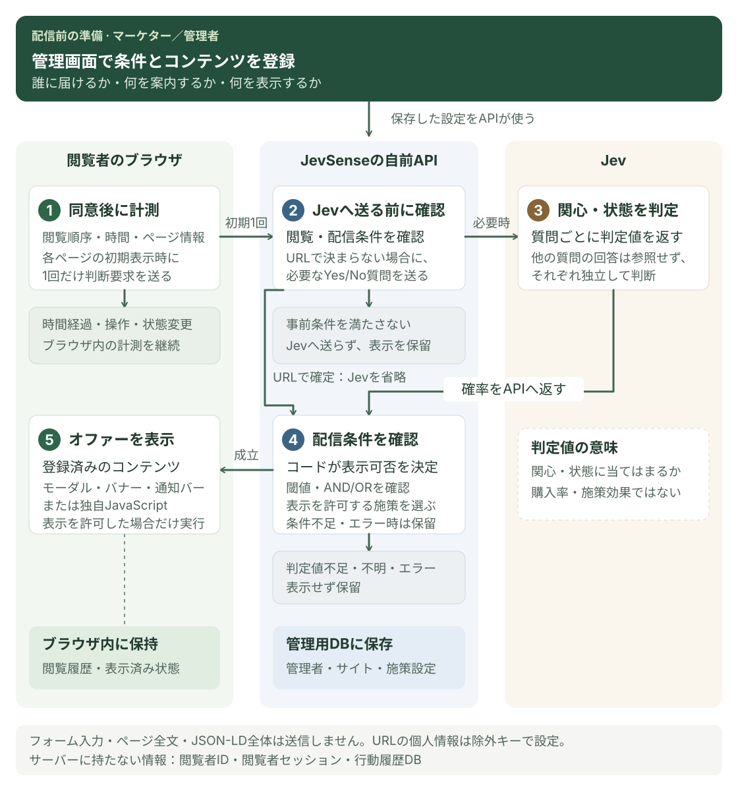

# JevSenseとは

JevSenseは訪問者の閲覧から関心や状態を判定し、用意した案内を適切な場面で表示するWebパーソナライズ基盤です。自分のCloudflareまたはNode.js環境で運用します。

## 向いている使い方

| サイト       | たとえば                                                   |
| ------------ | ---------------------------------------------------------- |
| EC           | 機能性ウェアに関心のある人へ、特集ページを案内する         |
| BtoB         | 導入や運用に関心のある人へ、導入ガイドを紹介する           |
| メディア     | 特定のテーマを続けて読んでいる人へ、関連記事を案内する     |
| 採用         | 開発環境に関心のある人へ、エンジニア向けイベントを紹介する |
| 教育         | 学習の進め方に関心のある人へ、説明会を案内する             |
| 予約サービス | 利用プランを検討している人へ、相談窓口を案内する           |

表示する文章・画像・リンク・JavaScriptは、管理者が事前に用意します。

## 判断はどのように行うか

管理画面で対象者の条件と案内する内容を設定し、表示するコンテンツを登録しておきます。計測のたびにJevへ問い合わせるわけではありません。ブラウザ内での計測、APIへの判断要求、Jevへの問い合わせには、それぞれ次へ進む条件があります。

[図を大きく表示する](/images/system-workflow.svg)。スマートフォンでは図を横にスクロールできます。

1. 共通SDKが同意後に閲覧順序・表示時間・ページ情報を観測します。
2. 初回のページ取得、最低閲覧時間への到達、許可された操作・状態の変化などをきっかけに、必要な情報を自前APIへ送ります。同じ状態で定期的に問い合わせる仕組みではありません。
3. APIが有効な閲覧や対象施策などを確認し、条件を満たす場合だけJevへstateと独立したYes/No質問を送ります。
4. Jevの判定値を受け、コードが閾値・AND/OR・表示制約などを確認します。
5. 表示を許可した場合だけ、登録済みのコンテンツを返し、SDKがページ上に表示します。

途中で次のように終わることもあります。

- **計測のみ**：判断のきっかけがない間は、ブラウザ内で計測を続けます。
- **APIで保留**：閲覧時間不足や対象施策なしの場合は、Jevへ送りません。キーの未設定や費用上限などでも問い合わせを止めます。
- **Jevへの問い合わせ後に保留**：判定値が閾値を満たさない、判断が不確か、通信や応答に問題がある場合は表示しません。

## 生成AIとの違い

Jevは対象者を判断するために使います。文章・画像・HTMLの生成には使いません。管理画面の入力支援も入力した文を固定の質問テンプレートへ当てはめる処理です。

判定値は「この関心・状態が当てはまるか」の判断材料です。購入率・施策効果・将来の行動の保証ではありません。

## 担当者ごとの入口

**施策を作る方**は管理者から招待を受けて[アカウント](../guides/accounts)を登録し、[施策を作成](../guides/campaigns)します。開発環境のインストールは不要です。

**導入する方**は、[Cloudflare](../getting-started/cloudflare)または[Node.js](../getting-started/node)をセットアップし、[SDKタグ](../integration/sdk)を設置します。

**運用する方**は[権限・秘密情報](../operations/security)、[更新と復旧](../operations/maintenance)を確認してください。

## 保存するデータ

閲覧者の履歴と表示済み状態はブラウザ内に持ちます。サーバーへ閲覧者ID・閲覧者セッション・行動履歴DBは追加しません。

管理者のアカウント・パスキー公開鍵・所属・施策設定は管理用DBへ保存します。外部送信がないという意味ではないので、[取得・送信データ](../integration/data)も確認してください。
